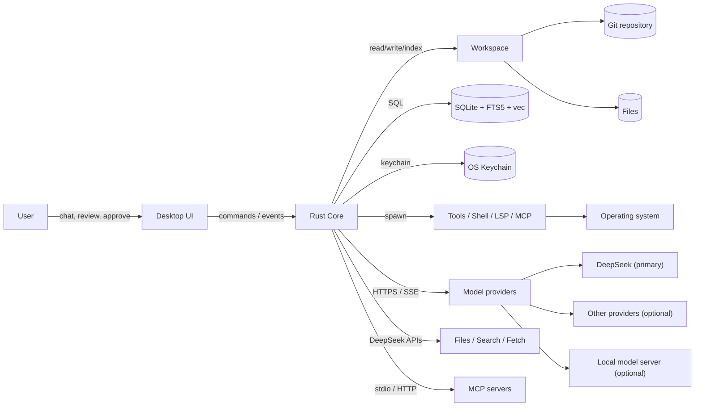
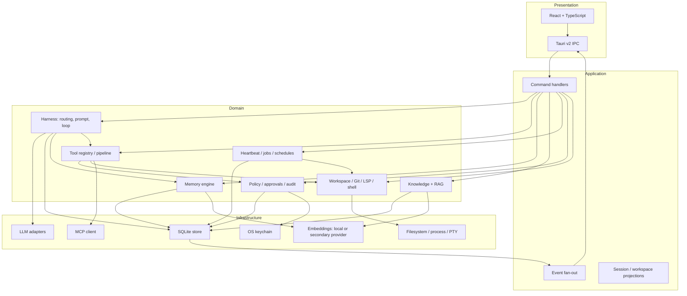
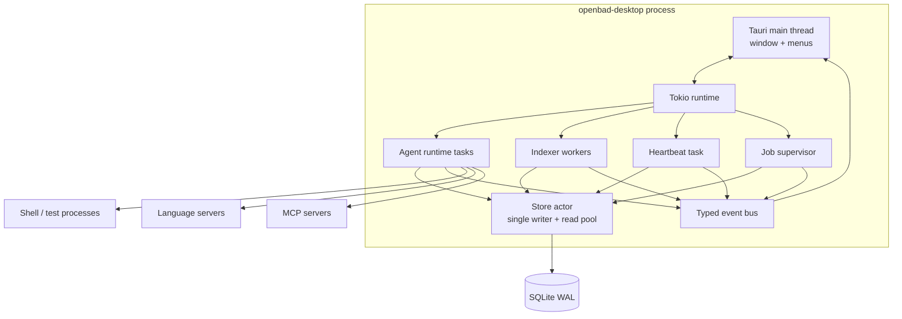
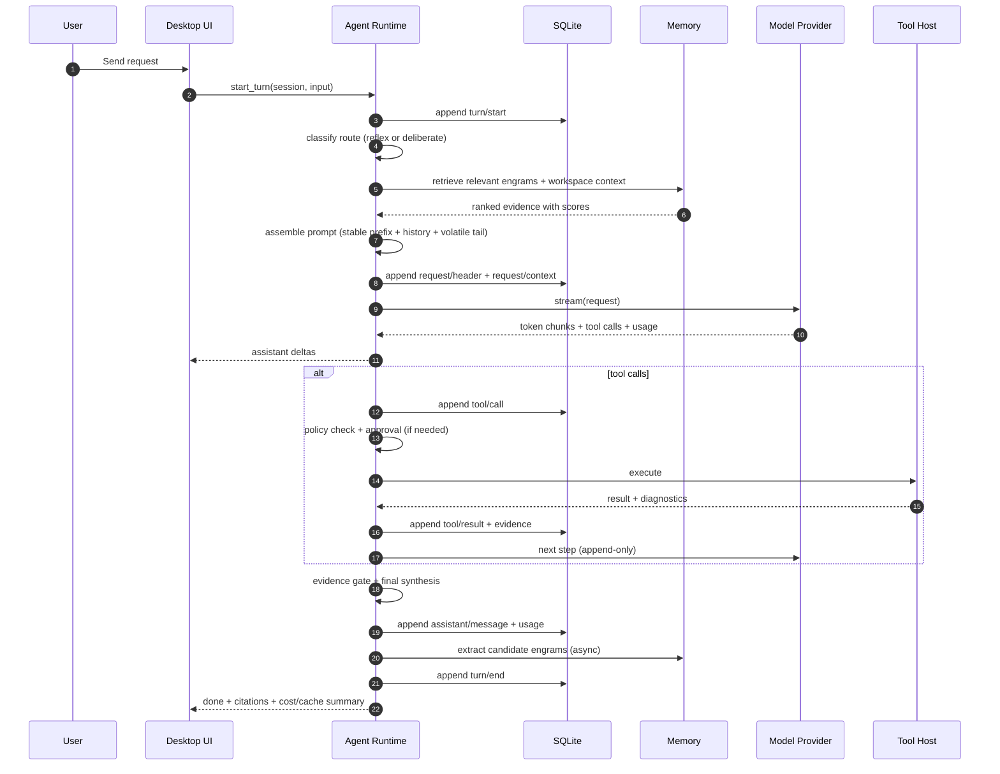
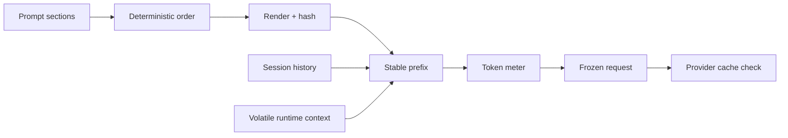
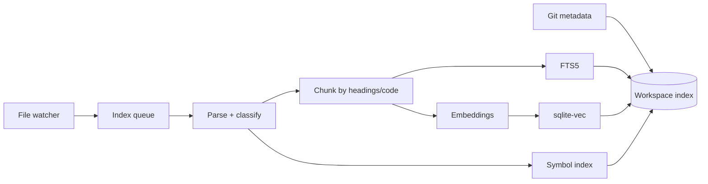
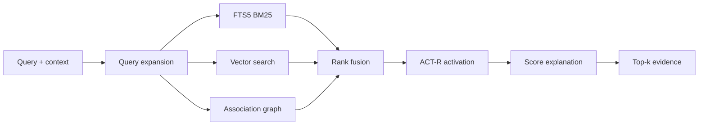
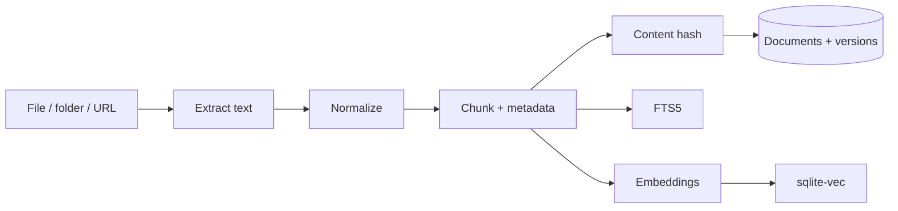

# 01 — System Overview

## 1. Scope

This document describes the runtime shape of OpenBaD Desktop: the major
components, how they communicate, the lifecycle of a turn, and the rules that
keep the system coherent. Detailed designs live in the referenced documents.

## 2. System context

External dependencies:

- **DeepSeek API** — required for the product's main generation, reasoning,
  extraction, classification, search, and fetch. The app is DeepSeek-first by
  design.
- **Other model providers** — optional fallbacks or capability gaps (for
  example, an embeddings endpoint, since DeepSeek does not expose one).
- **MCP servers** — optional, user-configured.
- **Git** — optional but expected for coding workflows.
- **Language servers** — optional, per-language.

SQLite is the local working store, chosen for latency and durability. It is not
a statement that data never leaves the machine: prompts and tool context are
sent to DeepSeek, and optional encrypted backup/sync can be enabled later.

## 3. Layered architecture

Rules:

- The **UI never touches SQLite or the filesystem directly**. It calls typed
  Tauri commands and subscribes to typed events.
- **Domain crates do not depend on infrastructure crates.** They depend on
  traits (`SessionStore`, `ModelProvider`, `ToolHost`, `Clock`, `FileSystem`).
- **The harness never constructs raw SQL.** It uses repositories and
  projections from `openbad-store`.
- **Tools never write directly to the session log.** They return a result; the
  agent loop validates, wraps it as evidence, and appends the event.

## 4. Component map

| Component | Responsibility | Crate |
| --- | --- | --- |
| Desktop shell | Window, menus, tray, shortcuts, updater | `apps/desktop` |
| UI | Chat, diff, plan, memory, knowledge, settings | `apps/desktop/ui` |
| Command bridge | Typed Tauri commands and event streams | `apps/desktop/src-tauri` |
| Session store | Event log, projections, migrations | `openbad-store` |
| Prompt assembler | Ordered sections, hashes, request envelopes | `openbad-harness` |
| Agent loop | Turn/step state machine, routing, retries, budgets | `openbad-harness` |
| Context manager | Token meter, compaction, spill, pruning | `openbad-harness` |
| Tool registry | Schemas, policy, execution pipeline | `openbad-tools` |
| Built-in tools | FS, search, shell, tests, Git, LSP, web | `openbad-tools` |
| Workspace service | Files, watcher, index, Git, LSP, PTY | `openbad-workspace` |
| Memory engine | Engrams, ACT-R, associations, retrieval | `openbad-memory` |
| Knowledge engine | Library, ingestion, chunking, embeddings | `openbad-knowledge` |
| Autonomic service | Heartbeat, jobs, schedules, pulse | `openbad-autonomic` |
| Governance | Policy, approvals, audit, redaction | `openbad-governance` |
| LLM adapters | DeepSeek, OpenAI-compatible, Anthropic, local | `openbad-llm` |
| MCP client | Server lifecycle, tools/resources/prompts | `openbad-mcp` |
| Updates | Release checks, download verification, installer handoff | `openbad-update` |
| Core types | IDs, events, config, errors, clock | `openbad-core` |

## 5. Runtime topology

The desktop app is a **single process** with supervised subsystems:

### Process and thread rules

| Concern | Rule |
| --- | --- |
| SQLite writes | Serialized through one writer actor; reads use a small pool. |
| Blocking work | `spawn_blocking` for DB, file IO, Git, and process spawning. |
| Agent streaming | One Tokio task per active step; cancellation via `CancellationToken`. |
| Tool execution | Read-only tools may run concurrently; mutating tools are serialized per workspace. |
| Subprocesses | Each child has a supervisor, timeout, and kill-on-drop guard. |
| UI updates | Coalesced at 30–60 Hz; token deltas are batched. |
| Crash safety | WAL + per-step checkpoints; interrupted turns are recoverable. |

## 6. Turn lifecycle

A **turn** is one user request (or scheduled trigger). A **step** is one model
request plus the tools it calls. A turn may contain zero or more steps.

### Turn guarantees

- The turn's model-visible history is derivable from the log at any point.
- Tool results are recorded exactly once and paired with their call.
- An interrupted turn still persists its partial assistant message and any
  completed tool results.
- A failed step does not emit a fabricated assistant message; it records an
  `assistant/attempt` event.
- Usage (including cache hit/miss) is attached to the assistant message.

## 7. Data flows

### 7.1 Prompt assembly

The prefix is composed of static system text, tool schemas, and workspace
context. History is append-only. Volatile context (time, git status, cursor,
context pressure) is appended at the tail. See
[Cache-First Harness](04-cache-first-harness.md).

### 7.2 Workspace indexing

### 7.3 Memory retrieval

### 7.4 Knowledge ingestion

## 8. Core invariants

| # | Invariant | Enforcement |
| --- | --- | --- |
| I1 | The session log is append-only. | No update/delete API; retention moves rows to archive tables. |
| I2 | Model-visible content is logged before the request is sent. | `prepare_call()` refuses to stream otherwise. |
| I3 | Stable prompt sections never contain volatile data. | Lint rules and tests on the section registry. |
| I4 | Tool schemas are sorted and versioned. | Registry canonicalizes; hash recorded per request. |
| I5 | History is never reordered or rewritten. | Surface projection is append-only; compaction inserts new events. |
| I6 | Every tool result is paired with its call. | Transactional append; pairing checks before compaction. |
| I7 | Every irreversible action has an approval decision or an explicit policy allow. | Tool pipeline checks policy before execution. |
| I8 | Secrets never enter the log or model context unredacted. | Redaction pass in tool output and prompt assembly. |
| I9 | A request series never silently changes model or tool schema. | Envelope comparison; new series is explicit and visible. |
| I10 | Every derived projection can be rebuilt from events. | Replay test in CI. |

## 9. Failure and cancellation model

| Failure | Behavior |
| --- | --- |
| Provider network error | Retry with exponential backoff; same request bytes; cache eligible. |
| DeepSeek outage | Queue or pause model work; local browsing, editing, and history remain available. |
| Provider context overflow | Compact oldest history, then retry; record `compaction/*`. |
| Provider auth error | Stop; surface actionable settings error; no retry. |
| Tool timeout | Kill process group; return error evidence; model may retry. |
| User cancel | Abort stream; persist partial assistant message as interrupted; kill tools. |
| App crash | Recover from WAL; replay to last committed event; mark incomplete turn. |
| DB corruption | Restore latest backup; export `doctor` report; never silently reset. |
| Disk full | Pause indexing and spill; surface Pulse alert; keep UI responsive. |
| Approval denied | Return a denied tool result; model must choose another approach. |

## 10. Upgrade and migration

- SQLite schema migrations run on startup in a transaction; backups are taken
  before destructive migrations.
- Session event formats are versioned. A migration chain upgrades old events on
  read and writes a new generation on next write.
- The app refuses to open a session written by a newer incompatible version
  rather than corrupting it.
- Updates are checked against GitHub releases and installed from Settings →
  About. Checksums are verified when the release publishes them, and a running
  AppImage is replaced atomically. The app can run offline for local browsing,
  editing, and history, but model-dependent features require DeepSeek
  connectivity.

## 11. What runs where

| Process | Started by | Lifetime |
| --- | --- | --- |
| Tauri window | App launch | App lifetime |
| Tokio runtime | App launch | App lifetime |
| Store actor | App launch | App lifetime |
| Heartbeat | App launch | App lifetime |
| Indexer workers | App launch | App lifetime (idle when nothing to do) |
| Shell/test process | Tool call | Command lifetime or background job |
| Language server | Workspace open | Workspace lifetime |
| MCP server | Settings/config | Session or app lifetime |
| Subagent | Agent call | Child session lifetime |

## 12. Related documents

- [Rust Workspace and Crates](02-rust-workspace-and-crates.md)
- [Data Model and Storage](03-data-model-and-storage.md)
- [Cache-First Harness](04-cache-first-harness.md)
- [Agent Runtime and Tools](05-agent-runtime-and-tools.md)
- [Desktop Application](08-desktop-application.md)
