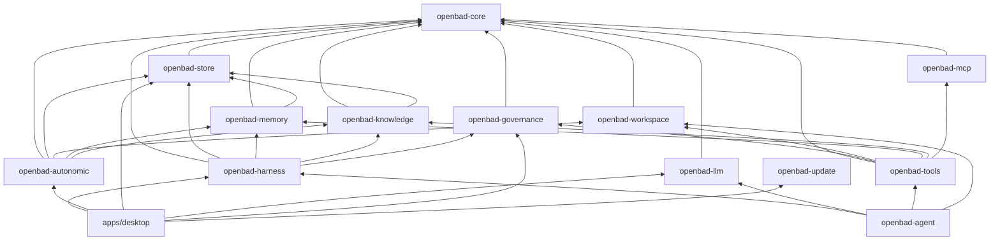

# 02 — Rust Workspace and Crates

## 1. Goals

- One Rust workspace for the core runtime.
- Clear dependency direction: domain → traits; infrastructure → domain.
- A thin Tauri application crate that wires everything together.
- Compile-time feature flags for heavy or optional capabilities.
- Fast incremental builds and testable seams.

## 2. Workspace layout

```text
OpenBaD/
├── Cargo.toml                     # workspace
├── rust-toolchain.toml            # pinned toolchain
├── rustfmt.toml
├── clippy.toml
├── apps/
│   └── desktop/
│       ├── src-tauri/
│       │   ├── Cargo.toml
│       │   ├── tauri.conf.json
│       │   ├── capabilities/
│       │   └── src/
│       │       ├── main.rs
│       │       ├── commands/
│       │       ├── events.rs
│       │       └── state.rs
│       └── ui/
│           ├── package.json
│           ├── vite.config.ts
│           ├── src/
│           │   ├── app/
│           │   ├── features/
│           │   ├── components/
│           │   ├── lib/
│           │   └── styles/
│           └── tests/
├── crates/
│   ├── openbad-core/
│   ├── openbad-store/          # includes migrations/
│   ├── openbad-harness/
│   ├── openbad-llm/
│   ├── openbad-agent/
│   ├── openbad-tools/
│   ├── openbad-workspace/
│   ├── openbad-memory/
│   ├── openbad-knowledge/
│   ├── openbad-autonomic/
│   ├── openbad-governance/
│   ├── openbad-mcp/
│   └── openbad-update/
├── tests/
│   ├── integration/
│   ├── fixtures/
│   └── e2e/
├── benches/
└── docs/
```

## 3. Crate responsibilities

| Crate | Owns | Must not own |
| --- | --- | --- |
| `openbad-core` | IDs, domain events, config types, errors, clock, capability traits, canonical JSON | SQL, HTTP, UI, process spawning |
| `openbad-store` | SQLite connection pool, migrations, repositories, projections, FTS, vector search | Business rules, prompt assembly |
| `openbad-harness` | Session runtime, routing, prompt assembly, token meter, compaction, evidence gate | Concrete provider APIs, concrete tools |
| `openbad-llm` | `ModelProvider` implementations, streaming, usage/cache normalization, cost model | Session persistence |
| `openbad-llm::deepseek` | DeepSeek chat, thinking, Files, Search/Fetch, FIM, prefix completion, cache accounting | Tool execution |
| `openbad-tools` | Tool registry, schemas, policy checks, execution pipeline, built-in tools | Agent loop |
| `openbad-agent` | Turn/step loop, tool dispatch, step budgets, usage accumulation | Provider wire formats, tool implementations |
| `openbad-workspace` | File tree, watcher, indexer, Git, LSP, PTY, process supervision | Memory/knowledge semantics |
| `openbad-memory` | Engrams, ACT-R, associations, extraction, consolidation, retrieval | UI |
| `openbad-knowledge` | Library, ingestion, chunking, embeddings, hybrid search | Chat UI |
| `openbad-autonomic` | Heartbeat, job supervisor, schedules, pulse metrics | Tool execution details |
| `openbad-governance` | Capability policy, risk classification, approvals, audit, redaction, secrets | Model calls |
| `openbad-mcp` | MCP server lifecycle, tool/resource/prompt import, auth | Agent loop |
| `openbad-update` | GitHub release checks, asset selection, checksum-verified downloads, AppImage and installer handoff | UI, session runtime |
| `openbad-terminal` | Persistent PTY sessions, output buffering, process-group cleanup | Agent loop |
| `apps/desktop/src-tauri` | Tauri commands, event bridge, window/tray/menu, updater | Domain logic |

## 4. Dependency graph



Rules:

- `openbad-core` has no internal dependencies.
- `openbad-store` is the only crate that imports a SQL driver.
- `openbad-harness` depends on traits, not concrete providers or tools.
- `openbad-tools` may depend on workspace/memory/knowledge services, but those
  services do not depend on tools.
- `apps/desktop` is the only crate that knows about Tauri.

## 5. Key libraries

| Concern | Crate | Why |
| --- | --- | --- |
| Async runtime | `tokio` | Mature, Tauri-compatible |
| Tauri | `tauri` v2 | Small binaries, OS integration, updater |
| Serialization | `serde`, `serde_json` | Typed events and JSON schemas |
| Canonical JSON | `json-canon` (RFC 8785) | Stable prompt/tool hashing |
| Hashing | `blake3` | Fast content hashes |
| IDs | `uuid` v7 | Time-sortable unique IDs |
| Errors | `thiserror` (domain), `anyhow` (app) | Typed vs. contextual errors |
| Logging | `tracing`, `tracing-subscriber`, `tracing-appender` | Structured logs |
| SQLite | `rusqlite` (bundled) | FTS5, extension loading, sync API |
| Pool | `r2d2`, `r2d2_sqlite` | Read connection pool |
| Migrations | Embedded SQL runner | `crates/openbad-store/migrations` + `schema_migrations` |
| HTTP | `reqwest` (rustls) | SSE and JSON APIs |
| SSE | `eventsource-stream` or `reqwest` byte stream | Streaming tokens |
| Process | `tokio::process`, `command-group`, `portable-pty` | Shell, PTY, process trees |
| File watch | `notify` | Incremental indexing |
| Git (read) | `git2` | Status, diff, log without shell parsing |
| Git (write) | `git` CLI | Hooks, credentials, push |
| Diff | `similar` | Patches and review |
| LSP | `lsp-types`, `lsp-server` | Language server protocol |
| JSON schema | `schemars` | Tool input/output schemas |
| Embeddings | `fastembed` | Local ONNX embeddings (DeepSeek has no embeddings endpoint) |
| Vector search | `sqlite-vec` | Embedded ANN/vector search |
| Token estimate | `tiktoken-rs` | Fallback token counting |
| Secrets | `keyring` | OS keychain |
| Glob | `globset`, `ignore` | Workspace-aware file matching |
| Syntax | `tree-sitter` + language packs | Chunking and symbol extraction |
| Cron | `cron` or `croner` | Schedules |
| Config | `figment` + `toml` | Layered configuration |
| Time | `time` or `chrono` | Timestamps (never in prompts) |
| Metrics | `metrics` + local sink | Counters and histograms |

## 6. Workspace `Cargo.toml`

```toml
[workspace]
resolver = "3"
members = [
    "apps/desktop/src-tauri",
    "crates/openbad-core",
    "crates/openbad-store",
    "crates/openbad-harness",
    "crates/openbad-llm",
    "crates/openbad-tools",
    "crates/openbad-workspace",
    "crates/openbad-memory",
    "crates/openbad-knowledge",
    "crates/openbad-autonomic",
    "crates/openbad-governance",
    "crates/openbad-mcp",
    "crates/openbad-update",
]

[workspace.package]
edition = "2024"
rust-version = "1.85"
license = "MIT"
version = "0.1.0"

[workspace.dependencies]
tokio = { version = "1", features = ["full"] }
serde = { version = "1", features = ["derive"] }
serde_json = "1"
thiserror = "2"
anyhow = "1"
tracing = "0.1"
uuid = { version = "1", features = ["v7", "serde"] }
blake3 = "1"
rusqlite = { version = "0.32", features = ["bundled", "backup", "functions", "limits"] }
refinery = { version = "0.8", features = ["rusqlite"] }
reqwest = { version = "0.12", default-features = false, features = ["json", "rustls-tls", "stream"] }
schemars = "0.8"
similar = "2"
notify = "7"
keyring = "3"
```

Exact versions are pinned in `Cargo.lock` and updated deliberately.

## 7. Feature flags

| Feature | Crate | Default | Effect |
| --- | --- | --- | --- |
| `deepseek-native` | `openbad-llm` | on | Files, Search/Fetch, FIM, prefix completion, thinking budgets |
| `local-embeddings` | `openbad-knowledge` | on | Bundle `fastembed`; used because DeepSeek has no embeddings endpoint |
| `provider-embeddings` | `openbad-knowledge` | off | Allow a secondary embeddings provider |
| `lsp` | `openbad-workspace` | on | Language server support |
| `pty` | `openbad-workspace` | on | Interactive terminal |
| `mcp` | `openbad-mcp` | on | MCP client |
| `sqlcipher` | `openbad-store` | off | Encrypted database at rest |
| `otel` | `openbad-autonomic` | off | OpenTelemetry export |
| `browser` | `openbad-tools` | off | Browser automation |
| `computer-use` | `openbad-tools` | off | Screen/input automation |
| `cloud-sync` | `openbad-store` | off | Optional encrypted backup/sync |

The default build should remain under 30 MB for the shell. Heavy features are
opt-in or lazily downloaded (for example, embedding models).

## 8. Tauri bridge

### Commands

Commands are grouped by domain and return `Result<T, CommandError>`:

```rust
#[tauri::command]
async fn start_turn(
    state: tauri::State<'_, AppState>,
    session_id: SessionId,
    input: UserInput,
) -> Result<TurnId, CommandError> {
    state.harness.start_turn(session_id, input).await
}
```

Rules:

- Commands are thin: validate, call a service, map errors.
- Long-running work returns an ID immediately; progress arrives as events.
- Commands never block the UI thread.
- Every command has an integration test against an in-memory or temp DB.

### Events

The core publishes a typed `AppEvent` stream. Tauri forwards batches:

```rust
#[derive(Serialize, Clone)]
#[serde(tag = "type", content = "data")]
enum AppEvent {
    TurnStarted { session_id: SessionId, turn: u32 },
    AssistantDelta { session_id: SessionId, turn: u32, text: String },
    ToolStarted { session_id: SessionId, call_id: ToolCallId, name: String },
    ToolFinished { session_id: SessionId, call_id: ToolCallId, ok: bool },
    ApprovalRequested { session_id: SessionId, request: ApprovalRequest },
    UsageRecorded { session_id: SessionId, usage: Usage },
    PulseUpdated { pulse: PulseSnapshot },
    TurnFinished { session_id: SessionId, turn: u32, reason: TurnEndReason },
}
```

The UI subscribes once and routes events into its stores.

### State

`AppState` holds `Arc` handles:

```rust
pub struct AppState {
    pub harness: Arc<Harness>,
    pub store: Arc<Store>,
    pub workspace: Arc<WorkspaceService>,
    pub memory: Arc<MemoryService>,
    pub knowledge: Arc<KnowledgeService>,
    pub governance: Arc<GovernanceService>,
    pub autonomic: Arc<AutonomicService>,
    pub events: broadcast::Sender<AppEvent>,
}
```

No global mutable singletons. Tests construct the same state with temp paths.

## 9. Testing layout

| Layer | Location | What it proves |
| --- | --- | --- |
| Unit | `crates/*/src/**/tests` or `#[cfg(test)]` | Pure logic, parsers, scoring |
| Integration | `tests/integration/` | Store + harness + mock provider |
| Provider contract | `tests/providers/` | Adapter behavior against recorded fixtures |
| UI | `apps/desktop/ui/tests/` | Components, stores, interactions |
| E2E | `tests/e2e/` | Tauri + mock provider + temp workspace |
| Benchmarks | `benches/` | Cache hit rate, token counts, latency, indexing |

### Test doubles

- `MockProvider`: deterministic streaming, scripted tool calls, usage with
  cache fields.
- `InMemoryStore`: the same traits as SQLite, for fast domain tests.
- `TempWorkspace`: fixture repo with Git history, files, and a known index.
- `FakeClock`: deterministic ACT-R decay and schedule tests.

## 10. Build profiles

```toml
[profile.dev]
opt-level = 0
debug = true

[profile.dev.package."*"]
opt-level = 2

[profile.release]
opt-level = 3
lto = "thin"
codegen-units = 1
panic = "abort"
strip = "symbols"

[profile.bench]
lto = "thin"
```

The split dev profile keeps dependencies optimized while the workspace stays
fast to rebuild.

## 11. Conventions

- No `unwrap()`/`expect()` in library code; return typed errors.
- No `unsafe` unless isolated, documented, and covered by tests.
- Public APIs have doc comments; private helpers do not need them.
- New dependencies require a license check (MIT, Apache-2.0, BSD only).
- Every crate exposes a `testing` module behind `#[cfg(any(test, feature = "testing"))]`.
- SQL lives in `crates/openbad-store/migrations/` and repository modules, never in domain crates.
