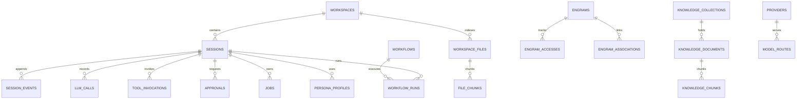

# 03 — Data Model and Storage

## 1. Storage choice

SQLite is the single system of record. It is embedded, zero-operations,
ACID-compliant, and fast enough for a desktop coding harness. FTS5 provides
BM25 search; `sqlite-vec` provides local vector search; JSON columns carry
extensible event payloads without a schema migration per event type.

See [ADR-002](../adr/002-sqlite-system-of-record.md).

## 2. Connection configuration

Every connection applies:

```sql
PRAGMA journal_mode = WAL;
PRAGMA synchronous = NORMAL;
PRAGMA foreign_keys = ON;
PRAGMA busy_timeout = 5000;
PRAGMA temp_store = MEMORY;
PRAGMA cache_size = -65536;          -- 64 MiB
PRAGMA mmap_size = 268435456;        -- 256 MiB
PRAGMA journal_size_limit = 67108864; -- 64 MiB
PRAGMA auto_vacuum = INCREMENTAL;
```

The `sqlite-vec` extension is registered before the first connection is pooled.
`rusqlite` is built with `bundled` so the app ships a known SQLite version.

### Concurrency model

- **One writer.** A dedicated store actor owns the write connection. All
  mutations are serialized. This avoids `SQLITE_BUSY` and keeps projection
  updates transactional.
- **Many readers.** An `r2d2` pool of read-only connections serves queries.
- **Blocking work.** All database calls run on `spawn_blocking`; they never run
  on the UI thread or inside a Tokio worker that is also awaiting a stream.
- **Long reads.** Indexing and consolidation use batched transactions
  (for example, 500 rows) to keep the WAL bounded.

## 3. Entity relationship diagram



## 4. Core tables

### 4.1 `workspaces`

```sql
CREATE TABLE workspaces (
    id              TEXT PRIMARY KEY NOT NULL,
    name            TEXT NOT NULL,
    path            TEXT NOT NULL UNIQUE,
    git_remote      TEXT,
    default_branch  TEXT,
    trust_state     TEXT NOT NULL DEFAULT 'untrusted'
                    CHECK (trust_state IN ('untrusted', 'trusted', 'restricted')),
    settings_json   TEXT NOT NULL DEFAULT '{}',
    created_at      INTEGER NOT NULL,
    updated_at      INTEGER NOT NULL,
    last_opened_at  INTEGER
);
```

### 4.2 `sessions`

```sql
CREATE TABLE sessions (
    id                  TEXT PRIMARY KEY NOT NULL,
    workspace_id        TEXT REFERENCES workspaces(id) ON DELETE SET NULL,
    parent_session_id   TEXT REFERENCES sessions(id) ON DELETE SET NULL,
    forked_from_seq     INTEGER,
    title               TEXT,
    status              TEXT NOT NULL DEFAULT 'active'
                        CHECK (status IN ('active', 'idle', 'archived', 'error')),
    model_route_id      TEXT REFERENCES model_routes(id) ON DELETE SET NULL,
    plan_mode           INTEGER NOT NULL DEFAULT 0,
    goal_json           TEXT,
    metadata_json       TEXT NOT NULL DEFAULT '{}',
    last_turn           INTEGER NOT NULL DEFAULT 0,
    created_at          INTEGER NOT NULL,
    updated_at          INTEGER NOT NULL,
    deleted_at          INTEGER
);

CREATE INDEX idx_sessions_workspace_updated
    ON sessions(workspace_id, updated_at DESC);
```

### 4.3 `session_events`

The append-only source of truth.

```sql
CREATE TABLE session_events (
    id              TEXT PRIMARY KEY NOT NULL,
    session_id      TEXT NOT NULL REFERENCES sessions(id) ON DELETE CASCADE,
    seq             INTEGER NOT NULL,
    turn            INTEGER,
    step            INTEGER,
    kind            TEXT NOT NULL,
    surface         INTEGER NOT NULL DEFAULT 0,
    payload_json    TEXT NOT NULL,
    search_text     TEXT,
    content_hash    BLOB,
    created_at      INTEGER NOT NULL,
    UNIQUE(session_id, seq)
);

CREATE INDEX idx_events_session_seq ON session_events(session_id, seq);
CREATE INDEX idx_events_session_kind ON session_events(session_id, kind, seq);
CREATE INDEX idx_events_session_turn ON session_events(session_id, turn, step);
CREATE INDEX idx_events_created ON session_events(created_at);
```

Rules:

- `seq` is contiguous per session and assigned inside the write transaction.
- `surface = 1` means the event contributes to the model-visible message
  history. `surface = 0` events are durable but invisible (attempts, headers,
  internal notes).
- `payload_json` is the canonical serialization of a typed event.
- `content_hash = BLAKE3(payload_json)` for tamper detection and dedupe.
- Rows are never updated or deleted by normal operation. Session deletion
  cascades, and retention archives to export files first.

#### Event kinds

| Kind | Surface | Payload summary |
| --- | --- | --- |
| `turn/start` | no | `{ turn }` |
| `turn/end` | no | `{ turn, reason, usage? }` |
| `step/start` | no | `{ turn, step, route }` |
| `step/end` | no | `{ turn, step, finish_reason }` |
| `user/message` | yes | `{ content, source, attachments? }` |
| `system/message` | yes | `{ content, prompt_version, section_hashes }` |
| `developer/message` | yes | `{ content, source }` |
| `assistant/message` | yes | `{ content, usage, interrupted? }` |
| `assistant/attempt` | no | `{ stream, error? }` |
| `tool/call` | yes | `{ call_id, name, arguments }` |
| `tool/result` | yes | `{ call_id, content, is_error, meta? }` |
| `approval/request` | no | `{ approval_id, risk, request }` |
| `approval/decision` | no | `{ approval_id, decision, reason? }` |
| `request/header` | no | `{ envelope, hashes }` |
| `request/context` | no | `{ volatile, hash }` |
| `usage/recorded` | no | `{ input, cache_read, cache_write, output, cost }` |
| `compaction/start` | no | `{ range, reason }` |
| `compaction/summary` | yes | `{ summary, range, model }` |
| `compaction/end` | no | `{ range, cache_reset_seq }` |
| `memory/recalled` | no | `{ engram_ids, scores }` |
| `memory/written` | no | `{ engram_ids }` |
| `evidence/accepted` | no | `{ evidence_ids }` |
| `evidence/rejected` | no | `{ evidence_ids, reasons }` |
| `job/started` | no | `{ job_id, kind }` |
| `job/finished` | no | `{ job_id, status, exit_code? }` |
| `schedule/fired` | no | `{ schedule_id, kind }` |
| `error` | no | `{ code, message, recoverable }` |

#### FTS for session search

```sql
CREATE VIRTUAL TABLE session_events_fts USING fts5(
    content,
    content='',
    tokenize='porter unicode61'
);
```

The application inserts `search_text` when `surface = 1`, keyed by
`session_events.rowid`. Deleting a session deletes its FTS rows first.

### 4.4 Projections

Projections are derived tables updated in the same transaction as the event
append. They can be rebuilt by replaying `session_events`.

```sql
CREATE TABLE session_messages (
    session_id  TEXT NOT NULL,
    seq         INTEGER NOT NULL,
    turn        INTEGER,
    step        INTEGER,
    role        TEXT NOT NULL,
    content_json TEXT NOT NULL,
    source      TEXT,
    created_at  INTEGER NOT NULL,
    PRIMARY KEY (session_id, seq)
);

CREATE TABLE session_turns (
    session_id      TEXT NOT NULL,
    turn            INTEGER NOT NULL,
    started_at      INTEGER NOT NULL,
    ended_at        INTEGER,
    reason          TEXT,
    steps           INTEGER NOT NULL DEFAULT 0,
    input_tokens    INTEGER NOT NULL DEFAULT 0,
    cache_read_tokens INTEGER NOT NULL DEFAULT 0,
    output_tokens   INTEGER NOT NULL DEFAULT 0,
    cost_usd        REAL NOT NULL DEFAULT 0,
    PRIMARY KEY (session_id, turn)
);

CREATE TABLE session_todos (
    session_id  TEXT NOT NULL,
    id          TEXT NOT NULL,
    title       TEXT NOT NULL,
    status      TEXT NOT NULL,
    detail      TEXT,
    ordinal     INTEGER NOT NULL,
    updated_at  INTEGER NOT NULL,
    PRIMARY KEY (session_id, id)
);
```

### 4.5 `llm_calls`

```sql
CREATE TABLE llm_calls (
    id                  TEXT PRIMARY KEY NOT NULL,
    session_id          TEXT REFERENCES sessions(id) ON DELETE CASCADE,
    turn                INTEGER,
    step                INTEGER,
    series_id           TEXT,
    route_id            TEXT,
    provider            TEXT NOT NULL,
    model               TEXT NOT NULL,
    api_format          TEXT NOT NULL DEFAULT 'openai', -- openai, anthropic, responses
    thinking_enabled    INTEGER NOT NULL DEFAULT 0,
    reasoning_effort    TEXT,
    user_id             TEXT,                            -- provider isolation key
    prompt_hash         BLOB,
    tools_hash          BLOB,
    workspace_hash      BLOB,
    request_bytes       INTEGER,
    input_tokens        INTEGER NOT NULL DEFAULT 0,
    cache_read_tokens   INTEGER NOT NULL DEFAULT 0,
    cache_write_tokens  INTEGER NOT NULL DEFAULT 0,
    output_tokens       INTEGER NOT NULL DEFAULT 0,
    reasoning_tokens    INTEGER NOT NULL DEFAULT 0,
    total_tokens        INTEGER NOT NULL DEFAULT 0,
    cost_usd            REAL NOT NULL DEFAULT 0,
    peak_pricing        INTEGER NOT NULL DEFAULT 0,
    latency_ms          INTEGER,
    first_token_ms      INTEGER,
    finish_reason       TEXT,
    status              TEXT NOT NULL,
    error_code          TEXT,
    created_at          INTEGER NOT NULL
);

CREATE INDEX idx_llm_calls_session ON llm_calls(session_id, created_at);
CREATE INDEX idx_llm_calls_provider_model ON llm_calls(provider, model, created_at);
```

`input_tokens` is **uncached input only**. Billed input is
`input_tokens + cache_read_tokens + cache_write_tokens`. This matches the
disjoint accounting used by DSH and avoids double counting.

### 4.6 `tool_invocations`

```sql
CREATE TABLE tool_invocations (
    id              TEXT PRIMARY KEY NOT NULL,
    session_id      TEXT NOT NULL REFERENCES sessions(id) ON DELETE CASCADE,
    turn            INTEGER,
    step            INTEGER,
    call_id         TEXT NOT NULL,
    tool_name       TEXT NOT NULL,
    args_json       TEXT NOT NULL,
    result_preview  TEXT,
    result_bytes    INTEGER,
    spilled_path    TEXT,
    success         INTEGER NOT NULL,
    error_code      TEXT,
    risk_level      TEXT,
    approval_id     TEXT REFERENCES approvals(id) ON DELETE SET NULL,
    duration_ms     INTEGER,
    created_at      INTEGER NOT NULL,
    UNIQUE(session_id, call_id)
);
```

### 4.7 `evidence`

```sql
CREATE TABLE evidence (
    id                  TEXT PRIMARY KEY NOT NULL,
    session_id          TEXT NOT NULL REFERENCES sessions(id) ON DELETE CASCADE,
    tool_invocation_id  TEXT REFERENCES tool_invocations(id) ON DELETE SET NULL,
    source_type         TEXT NOT NULL,
    source_name         TEXT NOT NULL,
    locator_json        TEXT,
    content             TEXT NOT NULL,
    content_hash        BLOB,
    confidence          REAL,
    retrieval_method    TEXT,
    observed_at         INTEGER,
    accepted            INTEGER NOT NULL DEFAULT 1,
    rejection_reason    TEXT
);

CREATE INDEX idx_evidence_session ON evidence(session_id, source_type);
```

`source_type` values: `file_span`, `command_output`, `test_result`,
`git_diff`, `lsp_diagnostic`, `knowledge_chunk`, `memory_engram`,
`web_source`, `user_clarification`, `direct_knowledge`.

### 4.8 `request_envelopes`

```sql
CREATE TABLE request_envelopes (
    id                  TEXT PRIMARY KEY NOT NULL,
    session_id          TEXT NOT NULL REFERENCES sessions(id) ON DELETE CASCADE,
    turn                INTEGER,
    step                INTEGER,
    series_id           TEXT NOT NULL,
    route_id            TEXT,
    provider            TEXT NOT NULL,
    model               TEXT NOT NULL,
    system_hash         BLOB NOT NULL,
    tools_hash          BLOB NOT NULL,
    workspace_hash      BLOB,
    volatile_hash       BLOB,
    envelope_json       TEXT NOT NULL,
    created_at          INTEGER NOT NULL
);
```

The envelope is the cache identity. A change to any hash within a series is
either an explicit new series or a bug.

## 5. Workspace and code index

### 5.1 `workspace_files`

```sql
CREATE TABLE workspace_files (
    id              TEXT PRIMARY KEY NOT NULL,
    workspace_id    TEXT NOT NULL REFERENCES workspaces(id) ON DELETE CASCADE,
    path            TEXT NOT NULL,
    language        TEXT,
    size_bytes      INTEGER NOT NULL,
    mtime           INTEGER NOT NULL,
    content_hash    BLOB NOT NULL,
    is_binary       INTEGER NOT NULL DEFAULT 0,
    is_ignored      INTEGER NOT NULL DEFAULT 0,
    indexed_at      INTEGER,
    UNIQUE(workspace_id, path)
);

CREATE INDEX idx_workspace_files_hash ON workspace_files(workspace_id, content_hash);
```

### 5.2 `file_chunks`

```sql
CREATE TABLE file_chunks (
    id              TEXT PRIMARY KEY NOT NULL,
    workspace_id    TEXT NOT NULL REFERENCES workspaces(id) ON DELETE CASCADE,
    file_id         TEXT NOT NULL REFERENCES workspace_files(id) ON DELETE CASCADE,
    ordinal         INTEGER NOT NULL,
    start_line      INTEGER NOT NULL,
    end_line        INTEGER NOT NULL,
    symbol          TEXT,
    content         TEXT NOT NULL,
    token_count     INTEGER NOT NULL,
    content_hash    BLOB NOT NULL,
    UNIQUE(file_id, ordinal)
);

CREATE INDEX idx_file_chunks_workspace ON file_chunks(workspace_id, file_id);
```

### 5.3 `symbols`

```sql
CREATE TABLE symbols (
    id              TEXT PRIMARY KEY NOT NULL,
    workspace_id    TEXT NOT NULL REFERENCES workspaces(id) ON DELETE CASCADE,
    file_id         TEXT NOT NULL REFERENCES workspace_files(id) ON DELETE CASCADE,
    name            TEXT NOT NULL,
    kind            TEXT NOT NULL,
    start_line      INTEGER NOT NULL,
    end_line        INTEGER NOT NULL,
    signature       TEXT,
    parent_id       TEXT REFERENCES symbols(id) ON DELETE CASCADE
);

CREATE INDEX idx_symbols_name ON symbols(workspace_id, name);
CREATE INDEX idx_symbols_file ON symbols(file_id, start_line);
```

### 5.4 Search indexes

```sql
-- Code search: trigram tokenizer handles identifiers and partial paths.
CREATE VIRTUAL TABLE file_chunks_fts USING fts5(
    content,
    symbol,
    content='',
    tokenize='trigram'
);

-- Vector index. Model dimension is fixed per database generation.
CREATE VIRTUAL TABLE file_chunk_vec USING vec0(
    chunk_id TEXT PRIMARY KEY,
    embedding FLOAT[768] distance_metric=cosine
);
```

A `vector_model` metadata row records the embedding model and dimension. Vectors
from different models are never compared. Changing the model triggers a
background re-embed into a new table and an atomic alias swap.

## 6. Knowledge library

### 6.0 Current project schema (`0006_project_areas`)

The desktop build currently stores project-owned knowledge and linked
repositories with this smaller schema:

```sql
CREATE TABLE project_repos (
    -- read-only reference folders attached to a project
    id           TEXT PRIMARY KEY NOT NULL,
    workspace_id TEXT NOT NULL REFERENCES workspaces(id) ON DELETE CASCADE,
    name         TEXT NOT NULL,
    path         TEXT NOT NULL,
    read_only    INTEGER NOT NULL DEFAULT 1,
    created_at   INTEGER NOT NULL,
    UNIQUE(workspace_id, path)
);

CREATE TABLE knowledge_documents (
    id           TEXT PRIMARY KEY NOT NULL,
    workspace_id TEXT NOT NULL REFERENCES workspaces(id) ON DELETE CASCADE,
    title        TEXT NOT NULL,
    kind         TEXT NOT NULL,
    source       TEXT,
    tags_json    TEXT NOT NULL DEFAULT '[]',
    content      TEXT NOT NULL,
    content_hash TEXT NOT NULL,
    created_at   INTEGER NOT NULL,
    updated_at   INTEGER NOT NULL
);

CREATE TABLE knowledge_chunks (
    id           TEXT PRIMARY KEY NOT NULL,
    document_id  TEXT NOT NULL REFERENCES knowledge_documents(id) ON DELETE CASCADE,
    workspace_id TEXT NOT NULL REFERENCES workspaces(id) ON DELETE CASCADE,
    seq          INTEGER NOT NULL,
    content      TEXT NOT NULL,
    UNIQUE(document_id, seq)
);

CREATE VIRTUAL TABLE knowledge_fts USING fts5(
    workspace_id UNINDEXED,
    document_id UNINDEXED,
    title UNINDEXED,
    seq UNINDEXED,
    content,
    tokenize = 'unicode61'
);
```

`project_overview` combines these counts with the existing workspace index
summary. `retrieve_project` fuses FTS5 ranks from `knowledge_fts`,
`workspace_fts`, and matching `memories`. The collection/version/vector schema
below remains the target design.

### 6.1 `knowledge_collections`

```sql
CREATE TABLE knowledge_collections (
    id          TEXT PRIMARY KEY NOT NULL,
    name        TEXT NOT NULL,
    kind        TEXT NOT NULL DEFAULT 'manual',
    description TEXT,
    created_at  INTEGER NOT NULL,
    updated_at  INTEGER NOT NULL
);
```

### 6.2 `knowledge_documents`

```sql
CREATE TABLE knowledge_documents (
    id              TEXT PRIMARY KEY NOT NULL,
    collection_id   TEXT NOT NULL REFERENCES knowledge_collections(id) ON DELETE CASCADE,
    title           TEXT NOT NULL,
    source_uri      TEXT,
    mime            TEXT,
    version         INTEGER NOT NULL DEFAULT 1,
    content_hash    BLOB NOT NULL,
    size_bytes      INTEGER NOT NULL,
    status          TEXT NOT NULL DEFAULT 'pending',
    metadata_json   TEXT NOT NULL DEFAULT '{}',
    created_at      INTEGER NOT NULL,
    updated_at      INTEGER NOT NULL
);
```

### 6.3 `knowledge_chunks`

```sql
CREATE TABLE knowledge_chunks (
    id              TEXT PRIMARY KEY NOT NULL,
    document_id     TEXT NOT NULL REFERENCES knowledge_documents(id) ON DELETE CASCADE,
    ordinal         INTEGER NOT NULL,
    heading_path    TEXT,
    start_offset    INTEGER,
    end_offset      INTEGER,
    content         TEXT NOT NULL,
    token_count     INTEGER NOT NULL,
    content_hash    BLOB NOT NULL,
    UNIQUE(document_id, ordinal)
);

CREATE VIRTUAL TABLE knowledge_chunks_fts USING fts5(
    content,
    heading_path,
    content='',
    tokenize='porter unicode61'
);

CREATE VIRTUAL TABLE knowledge_chunk_vec USING vec0(
    chunk_id TEXT PRIMARY KEY,
    embedding FLOAT[768] distance_metric=cosine
);
```

## 7. Cognitive memory

### 7.1 `engrams`

```sql
CREATE TABLE engrams (
    id                  TEXT PRIMARY KEY NOT NULL,
    scope               TEXT NOT NULL CHECK (scope IN ('global', 'workspace', 'session')),
    workspace_id        TEXT REFERENCES workspaces(id) ON DELETE CASCADE,
    session_id          TEXT REFERENCES sessions(id) ON DELETE CASCADE,
    category            TEXT NOT NULL,
    content             TEXT NOT NULL,
    source              TEXT NOT NULL,
    confidence          REAL NOT NULL DEFAULT 1.0,
    base_activation     REAL NOT NULL DEFAULT 0.0,
    decay_rate          REAL NOT NULL DEFAULT 0.5,
    access_count        INTEGER NOT NULL DEFAULT 0,
    created_at          INTEGER NOT NULL,
    last_accessed_at    INTEGER,
    is_active           INTEGER NOT NULL DEFAULT 1,
    pinned              INTEGER NOT NULL DEFAULT 0,
    superseded_by       TEXT REFERENCES engrams(id) ON DELETE SET NULL,
    source_refs_json    TEXT NOT NULL DEFAULT '[]',
    metadata_json       TEXT NOT NULL DEFAULT '{}',
    CHECK (
        (scope = 'global' AND workspace_id IS NULL AND session_id IS NULL) OR
        (scope = 'workspace' AND workspace_id IS NOT NULL) OR
        (scope = 'session' AND session_id IS NOT NULL)
    )
);

CREATE INDEX idx_engrams_scope ON engrams(scope, workspace_id, is_active);
CREATE INDEX idx_engrams_activation ON engrams(is_active, base_activation DESC);
```

### 7.2 Access and association tables

```sql
CREATE TABLE engram_accesses (
    id              TEXT PRIMARY KEY NOT NULL,
    engram_id       TEXT NOT NULL REFERENCES engrams(id) ON DELETE CASCADE,
    accessed_at     INTEGER NOT NULL,
    retrieval_method TEXT,
    query_hash      BLOB
);

CREATE INDEX idx_engram_accesses ON engram_accesses(engram_id, accessed_at);

CREATE TABLE engram_associations (
    from_id             TEXT NOT NULL REFERENCES engrams(id) ON DELETE CASCADE,
    to_id               TEXT NOT NULL REFERENCES engrams(id) ON DELETE CASCADE,
    weight              REAL NOT NULL DEFAULT 0.0,
    co_retrievals       INTEGER NOT NULL DEFAULT 0,
    last_co_retrieval_at INTEGER,
    PRIMARY KEY (from_id, to_id),
    CHECK (from_id <> to_id)
);

CREATE VIRTUAL TABLE engram_vec USING vec0(
    engram_id TEXT PRIMARY KEY,
    embedding FLOAT[768] distance_metric=cosine
);
```

## 8. Workflows, jobs, schedules, approvals, audit

### 8.1 `skills`

```sql
CREATE TABLE skills (
    id          TEXT PRIMARY KEY NOT NULL,
    name        TEXT NOT NULL UNIQUE,
    description TEXT,
    path        TEXT NOT NULL,
    version     TEXT,
    source      TEXT NOT NULL,
    enabled     INTEGER NOT NULL DEFAULT 1,
    created_at  INTEGER NOT NULL,
    updated_at  INTEGER NOT NULL
);
```

### 8.2 `workflows` and `workflow_runs`

```sql
CREATE TABLE workflows (
    id          TEXT PRIMARY KEY NOT NULL,
    name        TEXT NOT NULL UNIQUE,
    description TEXT,
    version     INTEGER NOT NULL DEFAULT 1,
    definition  TEXT NOT NULL,       -- TOML/YAML
    enabled     INTEGER NOT NULL DEFAULT 1,
    created_at  INTEGER NOT NULL,
    updated_at  INTEGER NOT NULL
);

CREATE TABLE workflow_runs (
    id              TEXT PRIMARY KEY NOT NULL,
    workflow_id     TEXT NOT NULL REFERENCES workflows(id) ON DELETE CASCADE,
    session_id      TEXT REFERENCES sessions(id) ON DELETE SET NULL,
    status          TEXT NOT NULL,
    current_step    TEXT,
    variables_json  TEXT NOT NULL DEFAULT '{}',
    error           TEXT,
    started_at      INTEGER NOT NULL,
    finished_at     INTEGER
);
```

### 8.3 `jobs`

```sql
CREATE TABLE jobs (
    id          TEXT PRIMARY KEY NOT NULL,
    kind        TEXT NOT NULL,
    status      TEXT NOT NULL
                CHECK (status IN ('queued', 'running', 'stopping', 'completed', 'failed', 'killed')),
    session_id  TEXT REFERENCES sessions(id) ON DELETE SET NULL,
    owner       TEXT NOT NULL,
    command     TEXT,
    cwd         TEXT,
    pid         INTEGER,
    progress_json TEXT,
    log_path    TEXT,
    exit_code   INTEGER,
    created_at  INTEGER NOT NULL,
    started_at  INTEGER,
    finished_at INTEGER
);
```

### 8.4 `schedules`

```sql
CREATE TABLE schedules (
    id          TEXT PRIMARY KEY NOT NULL,
    kind        TEXT NOT NULL,
    cron        TEXT NOT NULL,
    timezone    TEXT NOT NULL DEFAULT 'local',
    payload_json TEXT NOT NULL,
    session_id  TEXT REFERENCES sessions(id) ON DELETE SET NULL,
    status      TEXT NOT NULL DEFAULT 'active',
    next_run_at INTEGER,
    last_run_at INTEGER,
    created_at  INTEGER NOT NULL
);
```

### 8.5 `approvals`

```sql
CREATE TABLE approvals (
    id              TEXT PRIMARY KEY NOT NULL,
    session_id      TEXT NOT NULL REFERENCES sessions(id) ON DELETE CASCADE,
    tool_call_id    TEXT,
    risk_level      TEXT NOT NULL
                    CHECK (risk_level IN ('read', 'write', 'execute', 'network', 'destructive')),
    request_json    TEXT NOT NULL,
    decision        TEXT NOT NULL
                    CHECK (decision IN ('allow', 'allow_once', 'deny', 'expired')),
    decided_by      TEXT,
    reason          TEXT,
    created_at      INTEGER NOT NULL,
    decided_at      INTEGER,
    expires_at      INTEGER
);
```

### 8.6 `audit_log`

```sql
CREATE TABLE audit_log (
    id              TEXT PRIMARY KEY NOT NULL,
    ts              INTEGER NOT NULL,
    actor           TEXT NOT NULL,
    action          TEXT NOT NULL,
    target          TEXT,
    decision        TEXT,
    policy          TEXT,
    metadata_json   TEXT NOT NULL DEFAULT '{}',
    prev_hash       BLOB NOT NULL,
    hash            BLOB NOT NULL
);
```

`hash = BLAKE3(prev_hash || canonical_json(row))` forms a tamper-evident chain.
The app exposes an audit verification command.

## 9. Providers, routes, profiles, settings

### 9.1 `providers`

```sql
CREATE TABLE providers (
    id              TEXT PRIMARY KEY NOT NULL,
    kind            TEXT NOT NULL,      -- deepseek, openai, anthropic, ollama, ...
    name            TEXT NOT NULL,
    base_url        TEXT,
    keychain_ref    TEXT,               -- never the key itself
    enabled         INTEGER NOT NULL DEFAULT 1,
    created_at      INTEGER NOT NULL,
    updated_at      INTEGER NOT NULL
);
```

### 9.2 `model_routes`

```sql
CREATE TABLE model_routes (
    id                  TEXT PRIMARY KEY NOT NULL,
    name                TEXT NOT NULL UNIQUE,
    task_class          TEXT NOT NULL,   -- chat, code, review, extract, route, embed
    provider_id         TEXT NOT NULL REFERENCES providers(id) ON DELETE CASCADE,
    model               TEXT NOT NULL,
    context_window      INTEGER NOT NULL,
    max_output_tokens   INTEGER NOT NULL,
    pricing_json        TEXT NOT NULL DEFAULT '{}',
    peak_pricing_json   TEXT NOT NULL DEFAULT '{}',
    cache_mode          TEXT NOT NULL DEFAULT 'automatic',
    api_format          TEXT NOT NULL DEFAULT 'openai',
    thinking_default    TEXT NOT NULL DEFAULT 'enabled',
    capabilities_json   TEXT NOT NULL DEFAULT '{}',
    enabled             INTEGER NOT NULL DEFAULT 1
);
```

### 9.3 `deepseek_files`

Maps local images to DeepSeek Files API ids so an image is uploaded once and
referenced by `file_id` in later requests.

```sql
CREATE TABLE deepseek_files (
    id              TEXT PRIMARY KEY NOT NULL,
    content_hash    BLOB NOT NULL,
    file_id         TEXT NOT NULL,
    purpose         TEXT NOT NULL,       -- user_data
    size_bytes      INTEGER NOT NULL,
    uploaded_at     INTEGER NOT NULL,
    expires_at      INTEGER,
    last_used_at    INTEGER,
    UNIQUE(content_hash, purpose)
);
```

### 9.4 `embedding_models`

```sql
CREATE TABLE embedding_models (
    id              TEXT PRIMARY KEY NOT NULL,
    provider        TEXT NOT NULL,
    model           TEXT NOT NULL,
    dimensions      INTEGER NOT NULL,
    active          INTEGER NOT NULL DEFAULT 1,
    created_at      INTEGER NOT NULL
);
```

DeepSeek does not expose an embeddings endpoint, so the default is a local
ONNX model. A secondary provider can be configured; vectors from different
models are never mixed.

### 9.5 `persona_profiles`

```sql
CREATE TABLE persona_profiles (
    id              TEXT PRIMARY KEY NOT NULL,
    scope           TEXT NOT NULL CHECK (scope IN ('global', 'workspace')),
    workspace_id    TEXT REFERENCES workspaces(id) ON DELETE CASCADE,
    traits_json     TEXT NOT NULL DEFAULT '{}',
    preferences_json TEXT NOT NULL DEFAULT '{}',
    version         INTEGER NOT NULL DEFAULT 1,
    created_at      INTEGER NOT NULL,
    updated_at      INTEGER NOT NULL
);
```

### 9.6 `settings`

```sql
CREATE TABLE settings (
    key         TEXT PRIMARY KEY NOT NULL,
    value_json  TEXT NOT NULL,
    updated_at  INTEGER NOT NULL
);
```

## 10. Pulse and cache aggregates

```sql
CREATE TABLE pulse_samples (
    id              INTEGER PRIMARY KEY AUTOINCREMENT,
    ts              INTEGER NOT NULL,
    cpu_pct         REAL,
    mem_used_bytes  INTEGER,
    mem_total_bytes INTEGER,
    disk_free_bytes INTEGER,
    gpu_pct         REAL,
    vram_used_bytes INTEGER,
    db_bytes        INTEGER,
    wal_bytes       INTEGER,
    context_pressure REAL,
    token_spend_usd REAL,
    latency_ms      INTEGER,
    error_rate      REAL
);

CREATE INDEX idx_pulse_ts ON pulse_samples(ts);

CREATE TABLE cache_daily (
    day                 TEXT NOT NULL,
    provider            TEXT NOT NULL,
    model               TEXT NOT NULL,
    requests            INTEGER NOT NULL DEFAULT 0,
    input_tokens        INTEGER NOT NULL DEFAULT 0,
    cache_read_tokens   INTEGER NOT NULL DEFAULT 0,
    cache_write_tokens  INTEGER NOT NULL DEFAULT 0,
    output_tokens       INTEGER NOT NULL DEFAULT 0,
    cost_usd            REAL NOT NULL DEFAULT 0,
    PRIMARY KEY (day, provider, model)
);
```

`pulse_samples` retains 7 days. `cache_daily` is maintained from `llm_calls`
and retained indefinitely (tiny).

## 11. Migrations

- Migrations live in `crates/openbad-store/migrations/NNNN_description.sql`.
- A small embedded runner applies them in order inside a transaction and
  records each version in `schema_migrations`.
- Applied migrations are immutable. A fix is a new migration.
- Before a destructive migration, the app writes a backup and verifies it.
- `schema_version` is exposed to the UI's diagnostics panel.
- Tests apply all migrations to an empty database and assert the expected
  schema version.
- `refinery` can replace the runner later without changing the SQL files.

## 12. Backup, export, and retention

| Data | Retention | Backup |
| --- | --- | --- |
| `session_events` | Until session deleted | Yes |
| `llm_calls` | 1 year rolling | Yes |
| `audit_log` | Permanent | Yes |
| `pulse_samples` | 7 days | No |
| Spill files | 30 days | No |
| Checkpoints | 30 days | No |
| Knowledge documents | Until deleted | Yes |
| Engrams | Until forgotten/expired | Yes |

Backups use SQLite's online backup API or `VACUUM INTO`, written to
`<app_data>/backups/openbad-YYYYMMDD-HHMMSS.db`. Daily backups are kept for 7
days, weekly for 4 weeks. A backup is verified by opening it and running
`PRAGMA integrity_check`.

Session export writes a directory containing:

- `session.jsonl` — canonical events.
- `messages.md` — human-readable transcript.
- `attachments/` — referenced files.
- `manifest.json` — version, hashes, and provider metadata.

## 13. Query patterns and indexes

| Query | Index |
| --- | --- |
| Load session transcript | `session_events(session_id, seq)` |
| Rebuild model history | `session_messages(session_id, seq)` |
| Search sessions | `session_events_fts` |
| Latest usage/cost | `llm_calls(session_id, created_at)` |
| Memory candidates | `engrams(scope, workspace_id, is_active)` + `engram_vec` |
| Knowledge search | `knowledge_chunks_fts` + `knowledge_chunk_vec` |
| Code search | `file_chunks_fts` + `file_chunk_vec` |
| Job/schedule polling | `jobs(status)`, `schedules(next_run_at)` |

Queries that scan more than 10k rows must be justified and benchmarked.

## 14. Size estimates

| Data | Estimate |
| --- | --- |
| One turn (events + messages + usage) | 20–100 KB |
| 1,000-turn session | 20–100 MB with large tool outputs (spilled) |
| Code chunks (100k files, 10 chunks each) | ~1–3 GB text + ~1.2 GB vectors at 768 dims |
| Knowledge (10k pages) | ~100 MB text + ~120 MB vectors |
| Engrams (100k) | ~50 MB text + ~300 MB vectors |

These estimates drive the default limits:

- Max inline tool result: 8k tokens (spill above).
- Max indexed file size: 2 MB (configurable).
- Max workspace index: 250k files (warn, then sample).
- Max vector store: 2M chunks (warn, then require opt-in).
