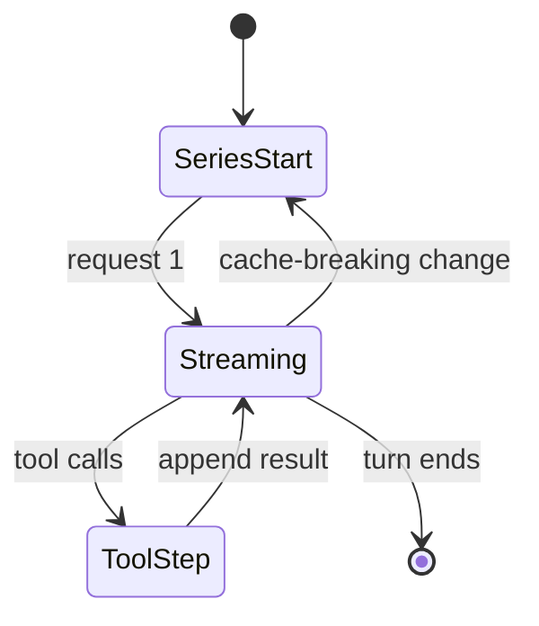

# 04 — Cache-First Harness

> **The model-visible prefix is immutable and append-only. Volatile context
> goes at the tail, never in the prefix.**

This document defines how OpenBaD assembles requests, preserves provider prefix
caches, measures cache hits, compacts context, and avoids the common behaviors
that silently destroy cache reuse.

## 1. Why cache-first

DeepSeek's API enables **Context Caching on Disk** by default. A request that
shares an exact prefix with a previously persisted prefix is billed at the
cache-hit rate for the overlapping tokens. With the current models the
difference is dramatic:

| Model | Context | Max output | Cache hit (off-peak) | Cache miss (off-peak) | Output (off-peak) |
| --- | --- | --- | --- | --- | --- |
| `deepseek-flash` | 1M | 384K | $0.003 / 1M | $0.15 / 1M | $0.60 / 1M |
| `deepseek-v4-pro` | 1M | 384K | $0.022 / 1M | $0.66 / 1M | $1.98 / 1M |

Peak rates are double the off-peak rates. A cache hit therefore costs about
**2% of a miss** on `deepseek-flash` and **3.3%** on `deepseek-v4-pro`. A coding
harness that preserves prefixes can cut input cost by an order of magnitude and
reduce time-to-first-token.

The cache is not a semantic cache. It matches token prefixes. That makes cache
behavior a **structural property of prompt assembly**, not a model feature we
can request at runtime.

### 1.1 DeepSeek capability map

| Capability | Use in OpenBaD |
| --- | --- |
| 1M context | Keep long, append-only histories; compact rarely |
| 384K max output | Large patches, reviews, and generated docs when needed |
| Thinking mode (`low`/`high`/`max`) | Per-task reasoning effort; default `high`, `low`/disabled for auxiliary work |
| `reasoning_content` passback | Required when `tools` are present |
| Prefix caching | Core cost/latency strategy |
| Files API | Upload images once; reference by `file_id` (images only) |
| Search API | In-house web search with citations |
| Fetch API | Fetch a URL as Markdown |
| FIM completion (beta) | Inline code completion, max 4K tokens, non-thinking only |
| Chat prefix completion (beta) | Constrained edits and forced output formats |
| Strict tool schemas (beta) | Schema-valid tool arguments |
| Anthropic-compatible API | Alternate wire format; supports mid-conversation system/tool inserts |
| Responses API | Alternate wire format with richer event semantics |
| `user_id` isolation | Per-install cache/safety/scheduling isolation |
| Off-peak pricing | Schedule maintenance and auxiliary work at half price |
| Balance API | Show account balance and budget status |

## 2. How DeepSeek context caching works

The rules that matter for the harness:

1. **Automatic disk cache.** Every request constructs cache entries; no code
   changes are required to opt in.
2. **Prefix units.** The provider persists cache prefix units at:
   - the end of the user input,
   - the end of the model output,
   - common prefixes detected across multiple requests,
   - fixed token intervals for long inputs/outputs.
3. **Full-match requirement.** A later request hits only if it **fully
   matches** a persisted prefix unit. A partial overlap that ends inside a unit
   does not count as a hit for that unit, though a shorter common prefix may be
   detected later.
4. **Append-only multi-turn is ideal.** Request 1 = `A + B`; request 2 =
   `A + B + C` hits the `A + B` unit.
5. **Divergence resets the reusable prefix.** Request 2 = `A + C` after
   `A + B` does not hit. Once the provider detects the shared `A` across
   requests, a later `A + D` can hit `A`.
6. **Cache construction takes seconds.** A cold prefix is not immediately
   reusable. Entries are cleared after hours to days of disuse.
7. **Usage reports hits and misses.** `prompt_cache_hit_tokens` and
   `prompt_cache_miss_tokens` are returned in `usage`.
8. **Output is still sampled.** Caching changes input cost/latency, not the
   randomness of generation.
9. **1M context.** The current DeepSeek models accept up to 1M input tokens,
   so compaction can be rare and the append-only history can stay intact for
   much longer.
10. **Thinking mode is epoch-level.** Switching thinking on/off or changing
    `reasoning_effort` changes the request shape; treat it like a model change.
11. **Reasoning passback is mandatory with tools.** When `tools` are present,
    the full `reasoning_content` of previous turns must be passed back or the
    API returns 400. Without `tools`, it is ignored.

### The engineering consequence

If the harness rewrites the system prompt, reorders tools, injects the current
time near the top, or edits prior messages, it pays the miss cost for
everything after the first changed token. The rest of this document is a set of
rules and mechanisms to prevent that.

## 3. Cache invariants

These invariants are enforced in code and tested in CI.

| # | Invariant | Enforcement |
| --- | --- | --- |
| C1 | Static prompt sections contain no timestamps, random IDs, or runtime state. | Section registry lint + unit tests. |
| C2 | Tool schemas are sorted by name and canonicalized. | Registry `schemas()` + hash test. |
| C3 | The tool schema set is stable for a request series. | Dynamic tools are exposed through stable proxy tools. |
| C4 | Conversation history is append-only. | Surface projection rejects rewrites. |
| C5 | Volatile runtime context is appended at the tail. | Prompt assembler places it after history. |
| C6 | Retries reuse the exact frozen request bytes. | Retry executor takes a `FrozenRequest`, not a builder. |
| C7 | Model and reasoning effort are epoch-level; changes start a new series. | Envelope guard. |
| C8 | Workspace context is snapshotted per series; file changes append tail messages. | Workspace fingerprint + explicit refresh. |
| C9 | Compaction is rare, boundary-aligned, and cache-reset-aware. | Compaction policy + UI indicator. |
| C10 | Tool output is spilled at creation, not rewritten later. | Tool result policy. |
| C11 | Every request records its cache identity hashes. | `request_envelopes` table. |
| C12 | Cache hit/miss is surfaced and never silently ignored. | Usage ledger + UI meter. |
| C13 | `reasoning_content` is passed back verbatim when tools are present. | Adapter guard; request replay test. |
| C14 | Thinking mode and effort are stable within a series. | Envelope guard. |

## 4. Prompt assembly

### 4.1 Section model

```rust
#[derive(Clone, Copy, Debug, Eq, PartialEq, Ord, PartialOrd)]
pub enum CacheClass {
    /// Never changes for a build + profile. Must contain no volatile data.
    Static,
    /// Changes only on an explicit workspace refresh.
    Workspace,
    /// Append-only conversation history.
    Session,
    /// Regenerated every turn; must be last.
    Volatile,
}

pub struct PromptSection {
    pub key: &'static str,
    pub order: u32,
    pub class: CacheClass,
    pub version: u64,
    pub content: String,
    pub hash: blake3::Hash,
}
```

### 4.2 Canonical order

| Order | Section | Class | Contents |
| --- | --- | --- | --- |
| 10 | `identity` | Static | Product identity, role, non-negotiable behavior |
| 20 | `operating_rules` | Static | Tool use, evidence, safety, approval, style |
| 30 | `tool_contract` | Static | How to call tools, output expectations, spill semantics |
| 40 | `operator_profile` | Static | Durable user preferences and expertise level |
| 50 | `tool_schemas` | Static | Canonical JSON schemas, sorted by tool name |
| 60 | `skills_index` | Static | Names + one-line descriptions only; bodies load on demand |
| 70 | `workspace_conventions` | Workspace | `AGENTS.md`, `CONTRIBUTING.md`, repo conventions |
| 80 | `workspace_map` | Workspace | Bounded repo map / key paths, snapshot at series start |
| 90 | `pinned_context` | Workspace | User-pinned files or notes, explicitly refreshed |
| 100 | `history` | Session | Append-only user/assistant/tool messages; the current user message is already the last entry |
| 110 | `runtime_context` | Volatile | Time, git status, selection, diagnostics, pressure; transient, not appended to history |

Rules:

- Sections 10–60 are the **stable prefix**. They must be byte-identical for
  the life of a series.
- The `tool_schemas` section is rendered into the provider's `tools` field, not
  concatenated into the system text. Its canonical bytes are still hashed for
  the request envelope.
- Sections 70–90 are the **workspace prefix**. They are snapshotted when a
  series starts or when the user explicitly refreshes context.
- Section 100 is append-only.
- Section 110 is regenerated each turn and is never cached across turns (it is
  the tail). It is logged as a non-surface `request/context` event for audit,
  but it is not part of the derived message history.
- The system prompt MUST state that a trailing `<runtime-context>` block is
  context, not a new user request.
- A section's `version` is bumped when its content changes. A changed static or
  workspace section **starts a new series**.

### 4.3 Assembly algorithm

The current user message MUST be appended to the session log before assembly.
The prompt plan therefore takes the history as-is; it does not accept a
separate turn input that could diverge from the log.

```rust
pub fn assemble_prompt(
    registry: &SectionRegistry,
    history: &[Message],
    runtime: RuntimeContext,
) -> Result<PromptPlan, PromptError> {
    let mut sections = registry.render_all()?; // deterministic, sorted by order
    sections.sort_by_key(|s| (s.order, s.key));

    // Refuse volatile content in stable classes.
    for section in sections.iter().filter(|s| s.class <= CacheClass::Workspace) {
        registry.assert_stable(section)?;
    }

    let stable_hash = hash_sections(&sections, CacheClass::Static);
    let workspace_hash = hash_sections(&sections, CacheClass::Workspace);
    let volatile = render_runtime(&runtime);

    Ok(PromptPlan {
        sections,
        history: history.to_vec(),
        volatile,
        stable_hash,
        workspace_hash,
    })
}
```

### 4.4 Rendering

```rust
fn render_plan(plan: &PromptPlan, provider: &dyn ModelProvider) -> RenderedRequest {
    let mut messages = Vec::new();

    // Static + workspace text sections become the leading system message.
    // Tool schemas are excluded: they are sent in the provider's `tools` field.
    let system_text = plan
        .sections
        .iter()
        .filter(|s| s.class <= CacheClass::Workspace && s.key != "tool_schemas")
        .map(|s| s.content.as_str())
        .collect::<Vec<_>>()
        .join("\n\n");
    messages.push(Message::system(system_text));

    // Append-only history, ending with the current user message.
    messages.extend(plan.history.iter().cloned());

    // Volatile tail: one small message, clearly marked.
    // Always a user message: a later system message would replace DeepSeek's
    // effective system prompt (the latest system message wins). The system
    // prompt tells the model that <runtime-context> is context, not a request.
    // This is transient: it is logged as request/context, not appended to
    // the derived history, so stale runtime data never accumulates.
    let runtime = format!("<runtime-context>\n{}\n</runtime-context>", plan.volatile);
    messages.push(Message::user(runtime));

    let tools = canonical_tool_schemas(provider);
    RenderedRequest { messages, tools }
}
```

### 4.5 Canonicalization and hashing

- JSON is canonicalized with RFC 8785 (JCS): sorted object keys, no insignificant
  whitespace, shortest number representation.
- Tool schemas are sorted by `name`; nested maps are canonicalized.
- Hashing uses BLAKE3 over the canonical bytes.
- The same input must produce the same bytes on every platform and run.

```rust
pub struct RequestEnvelope {
    pub series_id: Uuid,
    pub provider: String,
    pub model: String,
    pub api_format: ApiFormat,       // openai, anthropic, responses
    pub thinking_enabled: bool,
    pub reasoning_effort: Option<ReasoningEffort>, // low, high, max
    pub system_hash: Hash,
    pub tools_hash: Hash,
    pub workspace_hash: Hash,
    pub route: Route,
    pub max_output_tokens: u32,
    pub temperature: Option<f32>,
}
```

If any of `provider`, `model`, `api_format`, `thinking_enabled`,
`reasoning_effort`, `system_hash`, `tools_hash`, or `workspace_hash` differs
from the active series, the runtime MUST either:

1. start a new series explicitly (append `request/header` with
   `starts_series: true`), or
2. reject the call as a programming error.

## 5. Request series

A **request series** is a contiguous set of model calls that share a cacheable
prefix and model route.



### 5.1 What starts a new series

- First request in a session.
- Provider or model change (`deepseek-flash` ↔ `deepseek-v4-pro`).
- API format change (OpenAI ↔ Anthropic ↔ Responses).
- Thinking mode or reasoning effort change.
- Static prompt version change (app update, profile change, rule change).
- Tool schema set change (tool added/removed, MCP server connected).
- Explicit workspace context refresh.
- Compaction.
- Image offload or pruning of earlier tool results.
- Fallback to a different model.

### 5.2 What does not start a new series

- New user messages.
- Assistant messages and reasoning passback.
- Tool calls and tool results.
- Volatile runtime context.
- Retries of the same frozen request.
- New files read by tools (they append results; they do not rewrite the map).

### 5.3 Series start UX

When a series starts, the UI shows a small "cache reset" marker with the
reason. The cache meter switches to "warming". This makes cost behavior
transparent instead of surprising.

### 5.4 Optional cache warming

After a deliberate series start (app update, workspace refresh, compaction),
the runtime MAY warm the new prefix by issuing a minimal request in the
background:

- Only when the user is likely to continue within a few minutes.
- Only when the warm cost is below a configurable fraction of the expected
  saving.
- Never for a user who disabled background requests.
- The warm request is logged and billed like any other call.

Warming is an optimization, not a requirement. The default is **off**; the app
prefers paying one miss over spending tokens speculatively.

## 6. Dynamic tools without breaking the prefix

A naive harness injects every MCP tool into the schema list. Connecting a new
server then changes the schema hash and invalidates the entire prefix.

OpenBaD uses **stable proxy tools**:

| Proxy tool | Schema | Dynamic behavior |
| --- | --- | --- |
| `<domain>_list` / `<domain>_run` | stable | Lists a domain's tool schemas on demand, then dispatches one by name |
| `mcp_call` | stable | Arguments: `server`, `tool`, `arguments` |
| `skill` | stable | Arguments: `name`, `arguments`; loads skill body on demand |
| `tool_search` | stable | Searches the tool catalog and returns descriptions |
| `workflow` | stable | Runs a named workflow with typed input |

The actual catalog is injected as a **tail message** (or retrieved on demand),
not as part of the static tool schema. Tool descriptions for dynamic tools are
returned by tool calls and live in history. Built-in tools are grouped into
domains, so adding a tool to an existing domain changes neither the facade
schema nor the tool-schema hash; only adding a new domain does.

This keeps the tool schema hash stable across MCP server changes, skill
installs, tool additions, and tool discovery.

## 7. Volatile runtime context

Volatile context is necessary but must never enter the stable prefix. It is
rendered as one compact tail message:

```xml
<runtime-context>
now: 2026-10-19T20:36:22-04:00
workspace: /home/user/project (branch: main, dirty: 3 files)
selection: src/auth/session.rs:120-168
diagnostics: 2 errors, 5 warnings (rust-analyzer)
context: 42% used (61k / 145k), cache hit last turn: 91%
budget: $0.42 this session / $5.00 limit
</runtime-context>
```

Rules:

- Keep it under ~300 tokens.
- Never include secrets, full diffs, or large diagnostics.
- Put the most actionable facts first.
- Omit empty fields entirely.
- Render deterministically (stable field order) so changes are meaningful.
- Do not put the current request here; it goes last as the user message.

## 8. Compaction

Compaction replaces the oldest history with a summary. It is the largest
deliberate cache break, so it must be rare and well-timed.

### 8.1 When to compact

```rust
pub struct CompactionPolicy {
    pub compact_at: f32,          // default 0.80 of usable context
    pub hard_limit: f32,          // default 0.95
    pub keep_recent_turns: usize, // default 1 (previous + current turn)
    pub keep_recent_tokens: usize,// default 16% of usable context
    pub min_turns_between: u32,   // default 10
}
```

The 1M-token context changes the economics: keep append-only history far
longer, compact later, and compact less often. Every compaction is a cache
reset, so the default policy intentionally tolerates higher context pressure
before intervening.

Compaction triggers when:

- measured tokens exceed `compact_at`, or
- the provider returns a context-overflow error, or
- the user runs `/compact`.

### 8.2 Range selection

The range MUST:

- start at a turn boundary,
- end at a turn boundary; only a single turn larger than the summarizer
  window may end at a tool-pair boundary,
- preserve tool call/result pairs,
- leave at least `keep_recent_turns` and `keep_recent_tokens`,
- keep the previous and current user turns verbatim,
- not split a reasoning/message pair,
- prefer the oldest 40–70% of history.

### 8.3 Cache-preserving summarizer call

The summarizer replays the **exact** system prompt, tool schemas, and leading
messages from the last routed request, byte-for-byte, then appends the
compaction instruction as the final user message. This lets the summarizer
reuse the warm prefix; only the instruction and summary output are uncached.

```
[ system prompt + tool schemas ]        (cached)
[ messages in the compaction range ]    (cached)
[ user: compaction instruction ]        (uncached)
```

The summarizer uses the same provider and model route as the conversation.
Routing it to a different model forgoes prefix reuse and is not the default.

### 8.4 Summary structure

The checkpoint is a structured document, not a vague paragraph:

```markdown
## Goal
## Constraints and preferences
## Decisions and rationale
## Files and code touched
## Errors and fixes
## Pending work
## Current state
## Next step
## Critical context
```

The summary is inserted as a surface message with a marker:

```
<compacted-summary range="seq:12-84">
...
</compacted-summary>
```

### 8.5 Compaction algorithm

```rust
pub async fn compact(
    session: &Session,
    policy: &CompactionPolicy,
    provider: &dyn ModelProvider,
) -> Result<CompactionOutcome> {
    let measurement = token_meter.measure(session)?;
    if measurement.total_tokens < policy.threshold() {
        return Ok(CompactionOutcome::NotNeeded);
    }

    let range = select_range(session, policy)?;
    let prefix = replay_exact_prefix(session, range.start)?;
    let instruction = render_compaction_instruction(range);
    let summary = provider
        .summarize(prefix, instruction, CompactionBudget::default())
        .await?;

    session.append(CompactionStarted { range, reason: Reason::Pressure })?;
    session.append(CompactionSummary {
        summary: summary.text,
        range,
        model: provider.model_id(),
    })?;
    session.append(CompactionEnded {
        range,
        cache_reset_seq: range.end + 1,
    })?;

    Ok(CompactionOutcome::Compacted { range, cache_reset: true })
}
```

### 8.6 After compaction

- The next request is a new series. The cache meter shows "cold".
- Do not compact again for at least `min_turns_between` turns unless the
  provider demands it.
- Keep the original events for audit and export.
- The UI shows a "context compacted" marker with the seq range.
- If the summary is poor, the user can expand the original range (read-only)
  or ask the agent to re-read specific files.

## 9. Tool output handling

### 9.1 Spill at creation

Large tool outputs are spilled immediately:

| Threshold | Action |
| --- | --- |
| > 8k tokens or > 64 KiB | Write to spill file; return head/tail preview + locator |
| > 64k tokens | Return a short summary + locator; require a targeted read |
| Binary | Never inline; write file and return metadata |

The spill path is stable and session-scoped:

```
<app_data>/spill/session-<sha256(session_id)[..12]>/<call_id>-<safe_name>.txt
```

Spilling at creation keeps the tool result stable forever, so later turns do
not need to rewrite it.

### 9.2 Pruning

If context is still too large after spill, old tool results MAY be pruned
during compaction:

- Keep the head and tail, replace the middle with a marker and locator.
- Never prune a tool result that the model is actively referencing without
  appending a tail note.
- Pruning invalidates cache from the first changed result, so it happens only
  as part of a compaction series break, never mid-series.

### 9.3 Reading spilled data

The model uses `read_file`/`grep` on the spill path, or the `spill_read` tool
with a range. The result of that read is a **new** tail tool result. The
original spilled result is untouched.

## 10. Retry and fallback

| Situation | Behavior | Cache effect |
| --- | --- | --- |
| 429 / 5xx / timeout / stream reset | Retry with the same `FrozenRequest` bytes | Preserved |
| Malformed tool arguments | Append a corrective tail message, new step | Preserved up to the correction |
| Context overflow | Compact, then retry | New series |
| Auth / invalid request | Stop; surface error | N/A |
| Model fallback | New series with the fallback route | New cache |

The retry executor never rebuilds the prompt. It accepts a `FrozenRequest`:

```rust
pub struct FrozenRequest {
    pub bytes: Bytes,          // exact HTTP body
    pub envelope: RequestEnvelope,
    pub attempt: u32,
}
```

This guarantees that a retry is byte-identical and eligible for cache reuse.

## 11. Reasoning passback

DeepSeek's thinking mode returns chain-of-thought in `reasoning_content`.

- **With tools:** the full `reasoning_content` of every previous turn MUST be
  passed back. Omitting it produces a 400 error. It becomes part of the
  cacheable prefix.
- **Without tools:** `reasoning_content` is ignored by the API and is not
  concatenated into context. The harness may omit it from the request but keeps
  it in the event log.
- **Never rewrite or summarize prior reasoning inside a series.** That changes
  the prefix and can break tool-call correctness.
- **Thinking effort is epoch-level.** `low`, `high`, and `max` are stable for a
  series. Auxiliary calls use their own series and route.
- **Display:** raw reasoning is hidden by default behind a collapsible
  "Thinking" view. The final answer is the primary UI content.

## 12. Model and provider switching

Switching models mid-conversation invalidates the prefix cache. The app:

- Defaults to **same model for the session**.
- Warns before a manual switch: "Switching models resets the cache for this
  conversation. Continue?"
- Offers "switch and fork" — create a child session with the new model,
  preserving the old session's cache history.
- Routes cheap tasks (titles, extraction, classification) to a separate
  **auxiliary route** that never shares the main conversation prefix.
- Never silently falls back to a different model.

## 13. Cache accounting

### 13.1 Normalized usage

```rust
pub struct Usage {
    pub input_tokens: u64,        // uncached input only
    pub cache_read_tokens: u64,   // provider cache hit
    pub cache_write_tokens: u64,  // provider cache write (Anthropic)
    pub output_tokens: u64,
    pub reasoning_tokens: Option<u64>,
    pub total_tokens: Option<u64>,
}
```

`input_tokens + cache_read_tokens + cache_write_tokens` is billed input.
`reasoning_tokens` is included in `output_tokens` when the provider reports it
that way; the adapter normalizes to avoid double counting.

### 13.2 DeepSeek mapping

| Provider field | Normalized |
| --- | --- |
| `prompt_cache_hit_tokens` | `cache_read_tokens` |
| `prompt_cache_miss_tokens` | `input_tokens` |
| `prompt_tokens` | `input_tokens + cache_read_tokens` |
| `completion_tokens` | `output_tokens` |
| `reasoning_tokens` (when reported) | `reasoning_tokens` (also inside output) |

Pricing is resolved from the active model catalog entry and the request
timestamp:

| Model | Cache hit (off-peak / peak) | Cache miss (off-peak / peak) | Output (off-peak / peak) |
| --- | --- | --- | --- |
| `deepseek-flash` | $0.003 / $0.006 | $0.15 / $0.30 | $0.60 / $1.20 |
| `deepseek-v4-pro` | $0.022 / $0.044 | $0.66 / $1.32 | $1.98 / $3.96 |

Prices are per 1M tokens. Peak hours are 01:00–04:00 and 06:00–10:00 UTC,
Monday through Friday, excluding Chinese public holidays; all other hours are
off-peak. The ledger records `peak_pricing` per call so cost reports are
reproducible.

### 13.3 Cost

```text
cost =
  input_tokens        * miss_price
+ cache_read_tokens   * hit_price
+ cache_write_tokens  * write_price
+ output_tokens       * output_price
```

Prices live in the model catalog (user-editable), not in code. Unknown prices
show "unpriced" rather than a wrong number. The catalog can be refreshed from a
signed manifest when DeepSeek changes pricing.

### 13.4 Cache meter

The UI shows, per turn and per session:

- Cache-hit share: `cache_read / (input + cache_read + cache_write)`.
- Cache-read tokens and cache-miss tokens.
- Estimated cost and savings versus an all-miss baseline.
- Cache-reset events and their reason.
- A sparkline of hit rate over the last 20 turns.

## 14. Anti-patterns

| Anti-pattern | Why it hurts | Correct approach |
| --- | --- | --- |
| `Current date: ...` at the top of the system prompt | Changes every day/hour | Put time in the volatile tail |
| Reordering tool schemas | Changes the prefix | Sort by name; stable hash |
| Injecting all MCP tools into the schema | Server changes break cache | Stable proxy tools |
| Rebuilding the system prompt each turn | Tiny changes reset cache | Section registry + versioning |
| Editing a prior assistant message | Rewrites history | Append a correction |
| Rewriting a tool result to "clean it up" | Invalidates from that point | Spill at creation |
| Switching models mid-session | Full cache reset | Fork or explicit reset |
| Compacting every few turns | Repeated cold starts | Compact rarely, at boundaries |
| Dumping the repo map into the prefix | Large, stale, and costly | Bounded map + tool reads |
| Random IDs in tool descriptions | Non-deterministic bytes | Stable descriptions |
| Changing temperature every turn | May affect provider cache identity | Keep sampling stable per series |
| Stripping `reasoning_content` when tools are present | DeepSeek returns 400; breaks the series | Pass it back verbatim |
| Changing thinking mode or effort mid-series | Changes the request shape | Start a new series explicitly |
| Summarizing the whole history | Destroys recent working set | Keep recent turns intact |

## 15. Testing and benchmarks

### 15.1 Unit tests

- Section order is deterministic across runs and platforms.
- Stable sections contain no volatile patterns (timestamps, UUIDs, absolute
  paths outside workspace section).
- Tool schemas are sorted and canonical.
- A changed static section starts a new series.
- A new user message does not start a new series.
- Volatile context is always last.

### 15.2 Integration tests

- Mock provider records every request. Assert that turn 2's request bytes have
  turn 1's request as a prefix.
- Assert retry bytes are identical to the original.
- Assert compaction's summarizer request prefix equals the last routed
  request prefix.
- Assert spill keeps the tool result byte-identical across turns.
- Assert model switch starts a new series.

### 15.3 Benchmarks

See [Cache-First Benchmark Plan](../plans/0002-cache-first-benchmark-plan.md).

Targets:

| Metric | Target |
| --- | --- |
| Cache-hit share after turn 1 | ≥ 85% |
| Cache-hit share after turn 5 | ≥ 92% |
| Input cost vs. naive harness | −60% |
| Cost per completed task vs. naive harness | −40% |
| Prefix hash stability across 100 turns | 100% |
| Summarizer prefix reuse | 100% of compaction calls |

## 16. DeepSeek adapter checklist

- [ ] Support `deepseek-flash` and `deepseek-v4-pro` with 1M context and 384K output.
- [ ] Parse `prompt_cache_hit_tokens` and `prompt_cache_miss_tokens`.
- [ ] Pass `reasoning_content` back verbatim when `tools` are present.
- [ ] Treat thinking mode and `reasoning_effort` as epoch-level.
- [ ] Support `systemPromptUpdate: in-history` (Chat Completion accepts mid-conversation system messages).
- [ ] Use `strict` tool schemas (beta) and deterministic JSON serialization.
- [ ] Use the Files API for images; cache `file_id` by content hash.
- [ ] Use the Search and Fetch APIs for web research; capture citations.
- [ ] Use FIM completion for inline code completion (non-thinking, 4K max).
- [ ] Use chat prefix completion for constrained edits.
- [ ] Record peak/off-peak pricing and `user_id`.
- [ ] Keep request bytes frozen across retries.
- [ ] Emit usage before `assistant/message` is committed.
- [ ] Surface provider errors with actionable codes.
- [ ] Never inject provider-specific prose into the stable prompt.
- [ ] Test with a real DeepSeek key in the opt-in nightly job.

## 17. Provider portability

DeepSeek is the primary provider; the same cache-first design still helps if a
user configures another provider:

| Provider | Cache behavior | Harness adaptation |
| --- | --- | --- |
| **DeepSeek (primary)** | Automatic prefix cache | Native hit/miss accounting; 1M context; thinking mode |
| OpenAI | Automatic prompt caching | `cached_tokens` normalization |
| Anthropic | Explicit `cache_control` breakpoints | Mark stable prefix as cacheable |
| Google | Cached content objects | Stable prefix + cached content handle |
| Local (vLLM/llama.cpp) | Prefix/KV cache depending on server | Stable prefix still helps |

For Anthropic, the prompt assembler emits cache-control breakpoints at the end
of the static prefix and the workspace prefix. For providers without a cache,
the same discipline still reduces prompt churn and improves reproducibility.
DeepSeek-specific features (Files, Search/Fetch, FIM, prefix completion,
thinking mode) are optional capabilities on the provider trait; the harness
degrades gracefully when they are absent.

## 18. Related decisions

- [ADR-003: Event-sourced sessions](../adr/003-event-sourced-sessions.md)
- [ADR-004: Cache-first prompt assembly](../adr/004-cache-first-prompt-assembly.md)
- [ADR-007: DeepSeek-first provider strategy](../adr/007-deepseek-first-provider-strategy.md)
