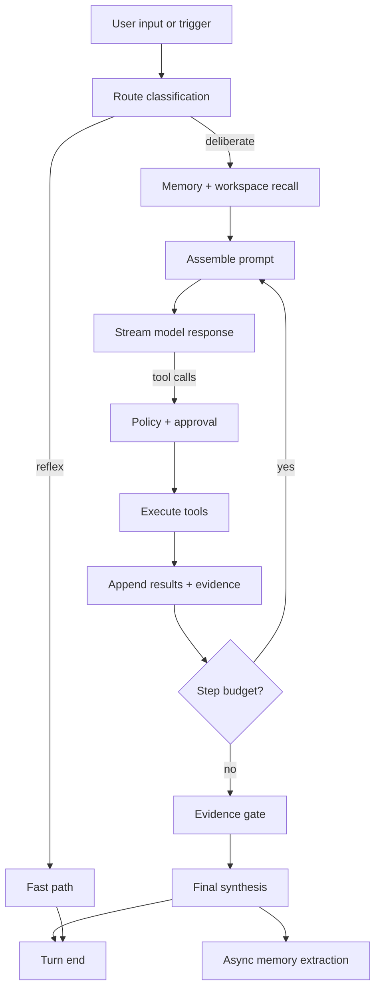
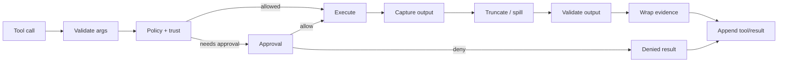

# 05 — Agent Runtime and Tools

## 1. Model

The agent runtime is a bounded, event-sourced loop. It is **not** an
unconstrained ReAct loop. Every model request, tool call, approval, and result
is a durable event. The loop is driven by explicit routes and hard budgets.



## 2. Turn and step semantics

| Concept | Definition |
| --- | --- |
| **Turn** | One user request or scheduled trigger. Opens before input is claimed and closes when no work remains. |
| **Step** | One model request plus the tool calls it requests. A turn has zero or more steps. |
| **Attempt** | One provider call within a step. Retries are attempts; only the settled result is model-visible. |
| **Series** | A contiguous set of steps sharing a cacheable prefix and model route. |

Rules:

- A turn with rejected or empty input closes without a step.
- Every step starts with a `step/start` event and ends with `step/end`.
- A failed attempt records `assistant/attempt` and does not fabricate an
  assistant message.
- Tool calls are paired with results; an interrupted step records missing
  results as errors.
- A human steering message is appended before the next provider request, so it
  redirects a running turn without creating a second turn. If the model has
  already produced a final answer, pending steering keeps the turn alive for
  one more step.
- The loop never exceeds its step, tool, token, time, or cost budget.

## 3. Routing

OpenBaD uses a dual-process policy borrowed from OpenBaD v0 and refined into a
routing table.

### 3.1 System 1 — reflex path

Cheap, deterministic, or small-model work:

- Direct answers from general knowledge.
- Simple file or symbol lookups.
- Command suggestion with no execution.
- Classification and extraction.
- Clarification questions.

Constraints:

- At most 1 model step.
- Read-only tools only.
- Low token budget.
- Escalates when confidence is low or the request implies mutation.

### 3.2 System 2 — deliberate path

Full agent loop with tools, planning, subagents, and evidence.

### 3.3 Route table

| Route | Use case | Tools | Mutates? | Path |
| --- | --- | --- | --- | --- |
| `direct_answer` | Explanation, general knowledge | none | no | reflex |
| `workspace_lookup` | "Where is X?", "How does Y work?" | search/read/LSP | no | reflex or deliberate |
| `knowledge` | Questions over library/docs | knowledge search, web | no | deliberate |
| `memory_recall` | "What did we decide?" | memory recall | no | reflex |
| `execute` | Run a command or test | shell, jobs | maybe | deliberate |
| `code_edit` | Add/change code | read/edit/patch/tests | yes | deliberate |
| `debug` | Diagnose a failure | shell, tests, read, LSP | maybe | deliberate |
| `review` | Review working tree or PR | git, read, tests | no | deliberate |
| `plan` | Produce a plan before work | read/search/LSP | no | deliberate |
| `workflow` | Run a deterministic playbook | workflow steps | maybe | deliberate |
| `clarify` | Ambiguous request | ask_user | no | reflex |

### 3.4 Classification

The router uses, in order:

1. **Explicit UI intent** (the user pressed "Review", "Plan", "Run tests").
2. **Deterministic heuristics** (slash commands, file mentions, code fences).
3. **Small router model** with a strict JSON schema.
4. **Fallback** to `workspace_lookup` for read-only safety.

The router output is logged as `step/start.route` and shown in the UI.

### 3.5 Model and thinking route

DeepSeek is the default for every route. `deepseek-flash` handles most work;
`deepseek-v4-pro` is reserved for hard reasoning, review, and planning.

| Route | Default model | Thinking | Effort |
| --- | --- | --- | --- |
| `direct_answer` | `deepseek-flash` | optional | low |
| `workspace_lookup` | `deepseek-flash` | off | low |
| `knowledge` | `deepseek-flash` | off | low |
| `memory_recall` | `deepseek-flash` | off | low |
| `execute` | `deepseek-flash` | off | low |
| `code_edit` | `deepseek-flash` | on | high |
| `debug` | `deepseek-v4-pro` | on | high |
| `review` | `deepseek-v4-pro` | on | high |
| `plan` | `deepseek-v4-pro` | on | high |
| `workflow` | per step | per step | per step |
| `clarify` | `deepseek-flash` | off | low |

Auxiliary work (titles, extraction, classification, summaries) uses
`deepseek-flash` with thinking disabled or `low`, on a separate route that
never shares the main conversation prefix. This keeps the primary series
cache-stable and cheap.

## 4. Event-sourced runtime

### 4.1 Event application

The runtime appends events through a `SessionHandle`:

```rust
impl SessionHandle {
    pub fn append(&self, kind: EventKind, payload: impl Serialize) -> Result<Seq>;
}
```

`append` does three things in one transaction:

1. Assigns the next `seq`.
2. Inserts into `session_events`.
3. Updates derived projections.

The in-memory projection is updated after the transaction commits. A
`SessionView` is a read-only snapshot for the UI.

### 4.2 Derived history

`derive_messages(session)` projects the model-visible history from events where
`surface = 1`:

- `system/message` → system message.
- `user/message` → user message.
- `developer/message` → developer message.
- `assistant/message` → assistant message (with reasoning and tool calls).
- `tool/call` → assistant tool-call block.
- `tool/result` → tool result message.
- `compaction/summary` → a user/developer message marking the checkpoint.

The derived history is frozen before a request. It never reads live UI state.

### 4.3 Replay

A session can be replayed from events to rebuild projections. Replay is used by
tests, export, crash recovery, and `doctor`.

## 5. Prompt assembly integration

The runtime calls the prompt assembler once per step:

```rust
let plan = prompt_assembler.assemble(
    &session,
    RouteContext { route, ui_context },
)?;
let frozen = provider.freeze(plan, &envelope)?;
let stream = provider.stream(frozen.clone()).await?;
```

The assembler owns the stable prefix; the runtime owns the history and the
volatile tail. The tail is logged as a non-surface `request/context` event, so
the exact request can be reconstructed without polluting derived history. See
[Cache-First Harness](04-cache-first-harness.md).

## 6. Tool model

### 6.1 Definition

```rust
pub struct ToolDefinition {
    pub name: ToolName,
    pub description: &'static str,
    pub input_schema: RootSchema,
    pub output_schema: RootSchema,
    pub risk: RiskLevel,
    pub approval: ApprovalPolicy,
    pub concurrency: Concurrency,
    pub timeout: Duration,
    pub strict: bool, // DeepSeek strict schema mode (beta)
    pub handler: Arc<dyn ToolHandler>,
}

#[async_trait]
pub trait ToolHandler: Send + Sync {
    async fn execute(
        &self,
        ctx: &ToolContext,
        args: serde_json::Value,
    ) -> Result<ToolOutput, ToolError>;
}
```

`ToolOutput`:

```rust
pub struct ToolOutput {
    pub content: Vec<ContentBlock>,     // model-visible
    pub meta: serde_json::Value,        // UI-only (diff, diagnostics, links)
    pub evidence: Vec<EvidenceCandidate>,
    pub spill: Option<SpillHint>,
    pub truncated: bool,
}
```

### 6.2 Registry

The registry scopes tools by session and workspace:

- **Built-in tools** — always available.
- **Workspace tools** — enabled by trust state and capabilities.
- **MCP tools** — exposed through `mcp_call`.
- **Skill tools** — exposed through `skill`.
- **Subagent tools** — a directed worker gets the normal built-in surface minus `subagent` itself, so depth stays at one.

The model-facing schema list is sorted by name and hashed. It is stable for a
series. Dynamic tools are proxied, not injected.

The built-in surface is capped at **128 tools**. The registry currently exposes
**115**, leaving 13 slots free. Every new capability must fit that budget; prefer
one stable proxy tool with an `action`/`operation` field over one tool per
operation, and keep at least four slots free for hotfixes.

LSP servers are configured in `.openbad/lsp.yaml`:

```yaml
servers:
  - language: rust
    command: rust-analyzer
    extensions: [rs]
    args: []
    initialization_options: {}
```

The `lsp` tool accepts one-based UTF-16 line and character coordinates,
returns one-based locations, caps results visibly, and reports a clear error
when no server is configured for the file type.

### 6.3 Execution pipeline



Rules:

- Argument validation happens before any side effect.
- Policy checks run before approval; a denied capability never prompts.
- Mutating tools are serialized per workspace.
- Read-only tools can run concurrently.
- Every tool has a timeout and a kill-on-drop guard.
- Output is validated against `output_schema`; invalid output is a tool error.
- Tool errors are returned as evidence with `is_error = true`, not panics.

## 7. Built-in tools

### 7.1 Files and search

| Tool | Risk | Concurrency | Notes |
| --- | --- | --- | --- |
| `read_file` | read | safe | Path, optional line range; content-addressed |
| `write_file` | write | serial | Requires a prior read in the session |
| `edit_file` | write | serial | Exact literal replacement; fails on ambiguity |
| `apply_patch` | write | serial | Unified diff; atomic per file set |
| `list_dir` | read | safe | Depth-limited |
| `glob` | read | safe | `.gitignore`-aware |
| `grep` | read | safe | Context lines, glob filter, max matches |
| `repo_map` | read | safe | Bounded structural map, not full content |
| `search_symbols` | read | safe | Symbol index / tree-sitter |
| `read_spill` | read | safe | Targeted read of a spilled artifact |
| `request_fs_access` | read | safe | Ask the human for read or write access to an absolute path outside the workspace |

Filesystem access outside the workspace is never inferred. When a read or
write is denied with `outside the workspace`, the assistant calls
`request_fs_access` with the absolute path, whether it needs write access, and
a reason. The tool only records a request and returns
`metadata.openbad_access_request`; it does not change policy. The human approves
or denies it in the desktop prompt. Approval inserts a project-scoped grant in
`outside_access_grants`, and later turns allow reads below that path (and
writes when requested). Read-only grants cannot be used by write tools.
Revoking a grant in Settings → Access takes effect on the next turn.

### 7.2 Execution

| Tool | Risk | Concurrency | Notes |
| --- | --- | --- | --- |
| `run_command` | execute | serial | PTY or pipe; cwd confined to the workspace unless `allow_external_cwd` and an approved write grant cover it |
| `start_job` | execute | serial | Background process with ID |
| `job_status` | read | safe | Status + progress |
| `job_logs` | read | safe | Tail with spill |
| `stop_job` | execute | serial | Graceful then kill |
| `run_tests` | execute | serial | Detect runner; structured result |

### 7.3 Git

| Tool | Risk | Notes |
| --- | --- | --- |
| `git_status` | read | Porcelain + branch |
| `git_diff` | read | Working tree or staged; path filter |
| `git_log` | read | Bounded |
| `git_blame` | read | Optional |
| `git_commit` | write | Requires approval; message + paths |
| `git_push` | destructive | Requires approval; never force by default |
| `git_checkout` | destructive | Requires approval when it would discard changes |

### 7.4 Code intelligence

| Tool | Risk | Notes |
| --- | --- | --- |
| `lsp_definition` | read | File, line, column |
| `lsp_references` | read | Bounded |
| `lsp_implementation` | read | Bounded |
| `lsp_hover` | read | Type/doc info |
| `lsp_diagnostics` | read | File or workspace |

### 7.5 Memory, knowledge, project areas, web

Implemented:

| Tool | Risk | Notes |
| --- | --- | --- |
| `recall` | read | Search indexed durable-memory snippets (atomic facts/preferences, not documents) |
| `remember` | write | Save one scoped snippet; contradictions require `supersedes`; use `add_knowledge` for documents |
| `list_project_sources` | read | Reference folders and knowledge documents |
| `search_project` | read | Fused knowledge documents, indexed code, and memory snippets with locators |
| `list_repo_dir` | read | List a reference-folder directory with sizes and `.gitignore` filtering |
| `glob_repo` | read | Find reference-folder files by glob |
| `grep_repo` | read | Search reference-folder text; case-insensitive by default |
| `read_repo_file` | read | UTF-8 file inside a read-only reference folder; reports total lines |
| `context_rules` | write | List, pin, or exclude `.openbad/context.yaml` residency rules |
| `list_context_rules` / `context_map` | read | Audit pinned/excluded rules and files loaded this turn |
| `ledger` | write/read | Claims, known unknowns, and ruled-out findings in `.openbad/*.json` |
| `ask_question` / `list_questions` | write/read | Queue structured human decisions in `.openbad/questions.json` |
| `canon` | write/read | Canon ledger, banned-phrase authoring/lint, and glossary lookup |
| `write_skill` | write | Durable procedure with preconditions, steps, verification, and rollback |
| `glossary_add` / `glossary_lookup` | write/read | Glossary terms, expansions, and aliases |
| `adr_write` / `adr_list` / `adr_read` | write/read | Architecture decision records |
| `yaml_query` | read | Query YAML documents by field and return line numbers (D7) |
| `check_invariants` | command | Run manifest invariant checks with evidence |
| `stat_file` / `stat_repo_file` | read | Size, line count, mtime, and BLAKE3 hash without loading content |
| `read_files` / `read_repo_files` | read | Batch reads with per-file errors and independent byte caps |
| `outline` | read | Markdown/AsciiDoc headings, YAML identifiers, or code declarations with line numbers |
| `delete_file` | write | Soft delete to `.openbad/trash`; hard delete requires `hard=true` |
| `job_start` / `job_status` / `job_logs` / `job_stop` / `job_list` | command/read | Background commands with logs under `.openbad/jobs` |
| `archive_list` / `archive_read` | read | Inspect zip entries without extraction |
| `diff_files` / `file_citation` | read | Cross-path diffs and stable `path@hash:line` citations |
| `git_changes_since` | read | Commits and changed paths since a revision |
| `registry_lookup` | read | crates.io/npm/PyPI version checks with network policy |
| `undo_last` | write | Restore the most recent write/edit from `.openbad/undo` |
| `instructions_for` | read | Load scoped AGENTS.md/CLAUDE.md/.openbad instructions root-first |
| `scaffold_project` | write | Create a starter manifest, README, docs, knowledge, scratch, artifacts |
| `workspace_gc` | write | Report or remove large generated files with confirmation |
| `session_checkpoint` / `session_resume` | write/read | Capture or restore plan/todos/handoff/claims/audit summaries |
| `references_to` | read | Blast-radius reference search for a file stem |
| `golden` | read/write | Snapshot regression comparison and baseline promotion |
| `plan_write` / `plan_read` / `plan_update_step` / `plan_verify` | write/read/command | Draft plan, human approval, and executable step verification |
| `context_report` | read | Estimate loaded files/knowledge/memory tokens and rules |
| `preview_write` | read | Unified diff for a proposed write without touching disk |
| `snapshot` | write/read | Create, list, or restore bounded workspace snapshots with explicit confirmation |
| `assert_project` | read | Count/schema/local-link structural assertions |
| `move_file` | write | Rename or move a file inside the workspace |
| `list_trash` / `restore_trash` | read/write | Inspect and restore soft-deleted files |
| `add_knowledge` | write | Add a curated project note with `verified`, `inferred`, or `uncertain` confidence |
| `list_knowledge` | read | List knowledge documents with ids, tags, sources, and chunk counts |
| `get_knowledge` | read | Read a whole knowledge document by id |
| `update_knowledge` | write | Correct title, content, source, tags, or confidence; rebuilds chunks |
| `delete_knowledge` | write | Delete a knowledge document and its retrieval chunks |
| `review_knowledge` | write | Proposed/accepted/rejected/superseded curation state |
| `export_knowledge` / `import_knowledge` | write | Git-friendly Markdown export/import under `knowledge/` |
| `list_memories` | read | Audit memories with ids, scope, provenance, and pinned state |
| `update_memory` | write | Correct memory content, tags, pinned state, or scope |
| `forget_memory` | write | Forget a memory by id |
| `git_commit` / `git_branch` / `git_checkout` | command | Safe git write verbs |
| `git_log` / `git_show` / `git_blame` / `git_stash` | read/command | Archaeology and stash management |
| `git_worktree` | command | Add, list, and remove worktrees |
| `repo_health` / `git_commit_context` | read | Ahead/behind, dirty state, and commit-message context |
| `github` | command | Full GitHub surface through `gh`: status, repositories, branches and protection, issues, labels, milestones, pull requests, reviews and merges, Actions, releases, Pages, search, and generic `gh api`; destructive actions require `confirm=true` |
| `subagent` | execute | Spawn, list, wait for, inspect, or cancel a focused background worker. `spawn` returns immediately; `wait` blocks until a terminal status or timeout, and `status` returns the result and recent activity. Workers inherit the session access mode and cannot spawn further workers |
| `plugin_list` / `plugin_describe` | read | Discover installed and bundled plugins and their actions |
| `plugin_call` / `plugin_test` | command | Run a plugin action or its declared test command with JSON stdin/stdout and evidence |
| `write_plugin` / `plugin_install_builtin` | write | Scaffold a plugin or install the bundled AsciiDoc plugin |
| `web_fetch` | read | Fetch http(s) docs, extract readable text, cache by hash, respect `network_hosts` |
| `present_artifact` | read | Open a web page, image, Markdown, diff, or file beside chat |
| `read_project_manifest` | read | Read `.openbad/project.yaml`: purpose, scope map, commands, invariants |
| `classify_path` | read | Classify a path as authoritative, generated, historical, or external |
| `run_task` | command | Run a named manifest command; requires Full access |
| `list_recipes` | read | List verification recipes declared in the project manifest |
| `run_recipe` | command | Run a lint/test/build/schema recipe; requires Full access |
| `list_gates` / `run_gate` | read/command | Run an ordered verification gate with evidence |
| `todo_write` | write | Replace the durable project todo list in `.openbad/todos.json` |
| `todo_read` | read | Read the project todo list |
| `write_handoff` | write | Write a handoff summary to `.openbad/handoff.md` |

The desktop implementation backs project tools with `StoreProjectAreas`, which
implements `ProjectAreas` against the active workspace id. `present_artifact`
returns `metadata.openbad_artifact`; the event stream carries that metadata to
the UI, which opens the split workspace.

Knowledge documents are typed (`note`, `decision`, `reference`, `gotcha`,
`procedure`, `glossary`, `finding`, `question`) and carry review state. A note
whose content likely contradicts an existing note must pass `supersedes`;
rejected and superseded documents remain auditable but leave retrieval. The
Markdown round trip writes `knowledge/*.md` with frontmatter so review can
happen in git.

Knowledge documents carry a confidence level and, for imported files, a BLAKE3
source hash. `list_knowledge` and `get_knowledge` flag a document as `STALE`
when the source file's current hash differs from the captured hash, and a
source that has disappeared is treated as stale.

The project-model sidecars are `.openbad/canon.yaml` (canonical,
superseded, disputed, unknown entries plus banned phrases),
`.openbad/glossary.yaml`, and `.openbad/adr/`. `canon_lint` reports obsolete
phrases with their canonical replacement and citation; `check_invariants` runs
declared invariant checks and writes evidence under `.openbad/invariants/`.

Manifest `gates:` group recipes into named pre-flight checks. `run_gate`
executes them in order and writes a JSON evidence file under `.openbad/gates/`.
When `prove_it: true`, the prompt requires every factual claim to cite an
executed check or be labelled UNVERIFIED.

`read_file` and `read_repo_file` accept `max_bytes` or `budget_tokens` and report
the effective cap. `context_report` estimates loaded evidence tokens and lists
rules. `ledger` kind claim stores executed/read/inferred/assumed provenance,
while kind unknown maintains the unresolved-question register.

`write_file` and `edit_file` screen content for obvious secrets (private keys,
cloud/API/GitHub/Slack tokens) before writing. `preview_write` lets the model
show a diff first. `snapshot` action create copies the workspace (excluding `.git`,
`target`, `node_modules`, `dist`, `.openbad`) under `.openbad/snapshots/`, and
`assert_project` provides count, schema, and local-link checks for gates.

`write_file` and `edit_file` run every manifest validator whose glob matches
the written path. Validators execute only in Full access; a failing validator
restores the previous file content and returns its output. Writes and edits that target
generated or historical scope return a manifest-derived warning.

Git and GitHub tools run through the same command policy and audit log. The
`github` tool drives `gh` and assumes it is authenticated (`gh auth login`);
it never embeds tokens. `area: "status"` reports authentication and the current
repository. Repository targeting accepts `repository: "owner/name"` or
`owner` + `repo`; otherwise `gh` uses the workspace repository. Merge, close,
delete, cancel, unpublish, approval, and change-request actions require an
explicit `confirm=true`. Release assets and run download destinations must be
workspace-relative. `dry_run: true` previews the exact `gh` command without
executing it, and `area: "api"` accepts a method, endpoint, fields, or a JSON
body for capabilities not yet surfaced explicitly.

The GitHub surface is:

| Area | Actions |
| --- | --- |
| `status` | authentication and current repository |
| `repo` | view, list, create, fork, edit, delete, archive, unarchive, rename, clone, sync |
| `branch` | list, get, create, delete, rename, protection, protect |
| `issue` | list, get, create, update, comment, close, reopen, delete, lock, unlock, pin, unpin, comments |
| `label` | list, create, edit, delete, clone |
| `milestone` | list, create, update, close, open, delete |
| `pr` | list, view, diff, files, commits, comments, create, update, comment, review, merge, close, reopen, ready, checks, checkout, update-branch, lock, unlock |
| `workflow` | list, view, dispatch, enable, disable |
| `run` | list, view, logs, artifacts, download, cancel, rerun, delete, watch |
| `release` | list, view, create, edit, upload, delete, download |
| `pages` | status, site, builds, build, request-build, unpublish |
| `search` | repos, issues, prs, code, commits |
| `api` | generic `gh api` with method, fields, JSON body, pagination, and jq |

Four skills ship inside the binary and are indexed in every prompt:
`github-workflow`, `github-releases-pages`, `plugin-development`, and
`asciidoc-rendering`. A workspace skill with the same name overrides the
built-in.

`.openbad/context.yaml` declares `pinned` and `excluded` globs. Excluded paths
are refused by direct reads and filtered from list, grep, glob, symbol, and
indexed-search results. `context_map` reports loaded files for the current turn,
the rules, and ruled-out findings. Ruled-out paths and hypotheses live in
`.openbad/dead-ends.json` and are injected into the system prompt.

`.openbad/permissions.yaml` can restrict writes by glob (`allow_paths`,
`deny_paths`, `allow_writes: false`) and commands by class or substring
(`command_classes`, `deny_command_patterns`, `allow_network`, `network_hosts`). Denials name the policy rule and
apply to file operations, `run_command`, `run_task`, and `run_recipe`.

Every write/edit records a bounded undo entry under `.openbad/undo`; `undo_last`
restores it. `instructions_for` discovers nested instruction files from the
workspace root down to the target path.

`scaffold_project` creates a reviewable starter layout. `session_checkpoint`
captures plan, todos, handoff, claims, unknowns, and recent audit entries for
`session_resume`. `instructions_for` also accepts a reference-folder id and
searches that repo's ancestors for `AGENTS.md`. `references_to` provides a
blast-radius preview and
`golden` action compare/accept manages committed baselines.

`plan_write` stores a draft in `.openbad/plan.json`; the prompt says not to
execute it until a human approves it in Project → Plan. `plan_verify` runs a
step's recipe/command and records pass/fail evidence. `ask_question` queues a decision with optional choices in
`.openbad/questions.json` instead of guessing or stalling. The Project →
Questions panel polls and writes the answer; the next system prompt includes
pending and recently answered questions.

Every tool call appends a bounded JSONL record to `.openbad/audit.jsonl`:
timestamp, turn, tool, argument/result BLAKE3 digests and 500-character
previews, error state, and duration. `run_command` tees its full output to
`.openbad/logs/command-<timestamp>.log` and returns head/tail plus the log path,
so large builds do not flood context.

Recipes and invariant checks may declare an absolute `cwd`; named tools pass
`allow_external_cwd` for declared recipes, while raw `run_command` refuses
absolute cwd unless explicitly allowed. `check: manual` (or `~`/`attested`)
records an attested, non-executed invariant. `canon_lint` skips fenced code,
`<!-- canon-lint: off -->` regions, and `paths_ignore` globs. `yaml_query`
flattens nested mappings and supports dotted paths/default fields.

`archive_list`/`archive_read` inspect zip archives in place. `diff_files`
compares workspace or reference files; `file_citation` emits
`path@blake3:Lstart-Lend` locators. `git_changes_since` summarizes drift, and
`registry_lookup` verifies package versions against crates.io, npm, or PyPI.

`web_fetch` accepts `max_tokens`/`budget_tokens` in addition to `max_bytes`.

`web_fetch` requires Full access, enforces the `network_hosts` allowlist
(including redirects), strips scripts/styles from HTML, and stores each body
under `.openbad/web-cache` by BLAKE3 hash with URL, title, content type, and
fetch time. `prefer_cache` reuses a recent fetch instead of hitting the network.

`run_command` accepts `parse` to extract structured diagnostics for Rust,
pytest, ESLint, and TypeScript; diagnostics are summarized in the result and
returned in metadata. Long-running commands can use the `job_*` tools, which
record PID and log files under `.openbad/jobs` and support explicit stop.

`run_command` classifies each command as `read-only`, `write-workspace`,
`network`, `destructive`, or `privileged`, reports the class in metadata, and
requires `confirm_destructive=true` before running destructive commands such as
`rm -rf` or `git reset --hard`. File deletion is reversible by default: the
file moves to `.openbad/trash` and can be restored by name.

`read_file` and `read_repo_file` return `total_lines`, `start_line`, `end_line`,
`has_more`, and `next_start_line` metadata. Reference discovery follows the
"list → glob → grep → bounded read" chain, avoiding guessed paths and line
offsets. Command denials name the access-mode cause and the Full access remedy.

Planned:

| Tool | Risk | Notes |
| --- | --- | --- |
| `search_knowledge` | read | Collection filter, vector/hybrid retrieval |
| `search_workspace` | read | Extended hybrid code search |
| `web_search` | network | DeepSeek Search API; returns URLs + snippets |
| `web_search` | network | DeepSeek Search API; returns URLs + snippets |
| `web_fetch` | network | DeepSeek Fetch API; returns Markdown + citation |
| `vision_analyze` | network | `deepseek-flash` vision + Files API |
| `complete_inline` | network | DeepSeek FIM (beta, 4K, non-thinking) |
| `complete_with_prefix` | network | DeepSeek chat prefix completion (beta) |

### 7.6 DeepSeek-native tool behavior

- **Search/Fetch** results are tagged as `web_source` evidence with URL, fetch
  time, and a quote. The model never gets an unfetched snippet as evidence.
- **Vision** uploads an image once via the Files API, caches the `file_id` by
  content hash, and references it in later requests instead of re-uploading.
- **FIM** is used by the editor for inline completion, not by the agent loop.
  It runs with thinking disabled and a 4K output cap.
- **Prefix completion** is used for constrained edits where the desired output
  must start with a known prefix (for example, a code fence or JSON shape).
- **Strict tool schemas** are enabled for built-in tools where the provider
  supports them, reducing malformed arguments.
- **Balance** is read from the Balance API and displayed in the Pulse/settings
  panel; it is not a model tool.

### 7.7 Control

| Tool | Risk | Notes |
| --- | --- | --- |
| `ask_user` | read | HITL question with options |
| `update_todo` | write | List replacement |
| `spawn_subagent` | execute | Depth/budget/tool scope |
| `mcp_call` | varies | Proxy with per-server policy |
| `skill` | varies | Load and run a skill |
| `workflow` | varies | Run a deterministic workflow |

## 8. Approvals and human-in-the-loop

### 8.1 Risk levels

| Level | Examples | Default |
| --- | --- | --- |
| `read` | read, grep, git status, LSP | Allow |
| `write` | edit, patch, remember, todo | Allow in trusted workspace; review diff |
| `execute` | shell, tests, jobs | Ask once per command class |
| `network` | web, MCP HTTP | Ask per domain or allowlist |
| `destructive` | delete, force push, reset | Always ask with explicit confirmation |

### 8.2 Approval request

```rust
pub struct ApprovalRequest {
    pub id: Uuid,
    pub session_id: SessionId,
    pub tool_call_id: ToolCallId,
    pub risk: RiskLevel,
    pub title: String,
    pub detail: String,
    pub diff: Option<Diff>,
    pub command: Option<String>,
    pub options: Vec<ApprovalOption>, // allow once, allow for session, deny
    pub expires_at: Option<Timestamp>,
}
```

The UI renders a modal with the exact command or diff. The model never sees the
approval UI; it receives an `is_error` tool result when denied.

### 8.3 HITL

- `ask_user` pauses the turn and persists the question.
- The UI resumes the turn with the answer.
- The answer is appended as a `user/message` with `source=clarification`.
- Unsaved tool calls are cancelled on pause.

## 9. Subagents

The main chat delegates a directed task through the `subagent` tool. A worker is
a full agent run in the same workspace, not a forked chat transcript.

```rust
pub struct SubagentSpec {
    pub task: String,
    pub title: String,
    pub model: Option<String>,
    pub allow_writes: bool,
    pub allow_commands: bool,
}
```

Rules:

- `action: "spawn"` starts the worker in the Tauri async runtime and returns an
  id immediately. The parent turn keeps going.
- `action: "wait"` polls until the worker reaches a terminal status or the
  timeout expires, then returns the result and recent activity. Use it instead
  of duplicating the worker's investigation.
- `action: "status"` returns a one-shot snapshot; `action: "list"` shows
  workers for the project; `action: "cancel"` sets the worker's cancellation
  flag.
- Workers inherit the parent session's access mode. `write: false` can narrow a
  worker to read-only, but a read-only parent cannot grant writes.
- Workers share the parent workspace, outside-access grants, memory, project
  knowledge, and indexed search.
- A worker gets a fresh context, a directed prompt, and the normal tool surface.
  The `subagent` tool is not available inside a worker, so depth is one.
- Worker records live in the `subagents` table with status, step count, activity
  log, result, error, model, and timestamps. The activity log is capped at
  32 KB. Terminal records are pruned automatically after 60 seconds (override
  with `OPENBAD_SUBAGENT_RETENTION_SECONDS`), so finished workers do not
  accumulate in the project Agents area.
- The project panel's Agents area lists workers, updates while one is running,
  opens a completed result as a Markdown artifact, and can cancel a running
  worker.
- If the app exits while a worker is running, its last persisted status is
  `running`; a later turn can inspect the record but cannot resume it.

Typical directed tasks:

- Map a codebase area and return file spans.
- Review a diff for bugs or security issues.
- Run a test suite, cluster failures, and report the first cause.
- Implement a scoped change when the parent session has write access.

## 10. Plan mode, todos, and goal loop

### 10.1 Plan mode

- Enabled by the user or the `plan` route.
- Tools are filtered to read-only.
- The model produces a structured plan:
  - goal, assumptions, steps, files, risks, validation.
- The plan is stored in `session_plan` and shown in the UI.
- "Approve plan" exits plan mode and seeds the todo list.

### 10.2 Todos

- `update_todo` replaces the list atomically.
- Todos are visible in the UI and persisted.
- The loop may auto-complete a todo only with evidence (test pass, file diff).

### 10.3 Goal loop

- A goal has success criteria, a budget, and a max round count.
- Each round: plan → act → verify → update.
- Stops on success, budget exhaustion, repeated failure, or user cancel.
- Every round is logged; the UI shows progress and spend.
- Approval gates still apply.

## 11. Skills

A skill is a markdown procedure with YAML frontmatter:

```markdown
---
name: rust-review
description: Review Rust changes for correctness, safety, and performance.
when_to_use: When the user asks for a Rust code review.
allowed_tools: [read_file, grep, git_diff, lsp_diagnostics]
version: 1
---
# Rust review checklist
...
```

Rules:

- Only the name and description enter the stable prompt index.
- The body loads on demand via `read_skill` and appends to history.
- Skill scripts run with the same approval policy as shell tools.
- Built-in skills cover GitHub workflows, releases and Pages, plugin
  development, and AsciiDoc rendering. They are always available.
- Workspace skills (`.openbad/skills`, `.claude/skills`) override built-ins by
  name; `.openbad` wins over `.claude`.
- A plugin may ship `SKILL.md`; it is indexed once the plugin is installed
  under `.openbad/plugins/<name>/`.
- Skills cannot silently add tools; `allowed_tools` narrows the set.

### 11.1 Plugin runtime

Plugins keep optional capabilities out of the core binary. A plugin lives in
`.openbad/plugins/<name>/` and declares a `plugin.yaml`:

```yaml
name: asciidoc
description: Render AsciiDoc with asciidoctor.
version: 0.1.0
command: python3 main.py
test_command: python3 -m py_compile main.py
timeout_seconds: 120
permissions: []          # write, network, or destructive
actions:
  render:
    description: Render a workspace .adoc file.
    input_schema: {type: object, properties: {path: {type: string}}}
```

The command runs from the plugin directory. It receives one JSON object on
stdin:

```json
{"plugin": "asciidoc", "action": "render", "arguments": {"path": "docs/guide.adoc"}, "workspace": "/path/to/project"}
```

It prints one JSON object on stdout:

```json
{"ok": true, "content": "rendered docs/guide.html", "metadata": {"bytes": 4211}}
```

`content`, `metadata`, and `is_error` are optional; non-JSON output is treated
as text and stderr is appended to failures. Each run is recorded under
`.openbad/plugin-runs/` with exit code, duration, and bounded stdout/stderr.
`plugin_call` and `plugin_test` require Full access, enforce the manifest
timeout, and honor `.openbad/permissions.yaml`. `permissions: [destructive]`
also requires `confirm=true`. `dry_run: true` returns the command and request
without execution.

`write_plugin` scaffolds `plugin.yaml`, a Python/Node/shell entrypoint,
`SKILL.md`, and `README.md`; the assistant then edits the entrypoint, runs
`plugin_test`, and exercises actions with `plugin_call`. The bundled AsciiDoc
plugin is installed with `plugin_install_builtin` and reports a missing
`asciidoctor` binary as an actionable failure instead of silently succeeding.

### 11.2 Inline completion and constrained edits

Two DeepSeek beta features are used outside the main agent loop:

### FIM completion

- Endpoint: `https://api.deepseek.com/beta` completions.
- Model: `deepseek-flash`, thinking disabled.
- Input: prefix + optional suffix; max 4K output.
- Use: editor inline completion, local refactors, test scaffolds.
- The result is shown as a ghost-text suggestion, never auto-applied.
- Accepted completions become normal edits with a checkpoint.

### Chat prefix completion

- Endpoint: `https://api.deepseek.com/beta` chat completions.
- The last message is an assistant message with `prefix: true`.
- Use: force a JSON shape, a code fence, or a known header.
- The result is validated before being applied.
- A failed validation is retried once with a corrective tail message, then
  surfaced to the user.

Both features use their own request series and never share the main
conversation prefix. Their usage is recorded in the same cost ledger.

## 12. Workflows

Workflows are deterministic playbooks, not free-form agent loops.

```toml
name = "release-check"
description = "Validate a release candidate."

[[steps]]
id = "tests"
tool = "run_tests"
args = { selector = "all" }

[[steps]]
id = "diff"
tool = "git_diff"
args = { staged = false }

[[steps]]
id = "review"
agent = { route = "review", prompt = "Review the diff for release risks." }

[[steps]]
id = "commit"
tool = "git_commit"
approval = "always"
```

Rules:

- Steps run in order unless a condition or loop changes flow.
- Variables come from input, environment, and prior step outputs.
- Tool names and schemas are validated at load time.
- Agent steps are bounded and read-only by default.
- Every step emits a `workflow/step` event; failures stop or branch explicitly.
- Workflows are versioned and exportable.

## 13. MCP and native connectors

### 13.1 Connector model

OpenBaD keeps Clarity's typed connector idea but does not rebuild its bespoke
framework. There are two layers:

1. **MCP-first** — third-party tools, resources, and prompts are integrated
   through MCP servers. This is the default extension path.
2. **Native connectors** — a thin trait pair for capabilities where MCP is a
   poor fit: Git/GitHub, DeepSeek Search/Fetch, and the local filesystem.

```rust
#[async_trait]
pub trait DataConnector: Send + Sync {
    async fn query(&self, request: DataRequest) -> Result<DataResponse>;
}

#[async_trait]
pub trait ActionConnector: Send + Sync {
    fn risk(&self) -> RiskLevel;
    async fn execute(&self, action: ActionRequest) -> Result<ActionResult>;
}
```

Rules:

- Native connectors are compiled in and capability-gated.
- They use the same policy, approval, evidence, and audit pipeline as tools.
- Credentials live in the OS keychain.
- MCP output is untrusted; native connector output is treated as data too.
- A connector cannot register tools or change policy at runtime.

### 13.2 MCP

- Transports: stdio and streamable HTTP.
- Server config: command/URL, args, env, cwd, timeout, allowed tools.
- Tools are imported and called through `mcp_call` to keep the schema stable.
- Resources are read through a typed `mcp_read_resource` tool.
- Prompts are loaded through `mcp_prompt`.
- Health checks and crash backoff.
- Credentials live in the OS keychain.
- Untrusted MCP output is tagged as untrusted content.

## 14. Evidence gate

The evidence gate is a deterministic node with no model call. It filters
evidence before final synthesis.

### 14.1 Acceptance rules

| Source | Required fields | Rejected when |
| --- | --- | --- |
| `file_span` | path, start line, end line, content | No line range; content is a summary |
| `command_output` | command, cwd, exit code, output | Older than 30 minutes for stateful commands |
| `test_result` | command, passed/failed counts, failure excerpt | No counts; no failure output |
| `git_diff` | base/head or working tree, paths, patch | Empty or binary only |
| `lsp_diagnostic` | file, range, severity, message | Stale workspace version |
| `knowledge_chunk` | document id, chunk id, heading path | Missing citation metadata |
| `memory_engram` | engram id, content, activation | Inactive or below threshold |
| `web_source` | URL, fetched_at, quote | No URL or quote; stale beyond policy |
| `user_clarification` | question id, answer | Missing question |
| `direct_knowledge` | none | Any route other than `direct_answer` |

### 14.2 Gate output

- Accepted evidence is attached to the assistant message as citations.
- Rejected evidence is logged with a reason and hidden from the model.
- If no evidence remains for a route that requires it, the agent must say so
  or ask a clarifying question; it must not invent an answer.

## 15. Budgets and cancellation

```rust
pub struct TurnBudget {
    pub max_steps: u32,          // default 0 = unlimited; explicit cap optional
    pub max_tool_calls: u32,     // default 64
    pub max_input_tokens: u64,   // default 400_000 (of 1M)
    pub max_output_tokens: u64,  // default 32_000 (max 384K)
    pub max_thinking_tokens: u64,// default 32_000
    pub max_cost_usd: f64,       // workspace policy
    pub max_wall_time: Duration, // default 10 minutes
}
```

- Budget checks run before each step and each tool call.
- Exhaustion produces a partial result with a clear reason and next steps.
- Cancellation propagates to the provider stream and all child processes.
- A cancelled turn preserves partial assistant text and completed tool results.
- A repeated-failure guard stops loops after N identical failures.

## 16. Runtime pseudocode

```rust
pub async fn run_turn(
    session: &SessionHandle,
    input: UserInput,
    policy: &TurnPolicy,
) -> Result<TurnOutcome> {
    let turn = session.append(TurnStart, ())?;
    let route = router.classify(&input, &session.view()).await?;
    session.append(StepStart { route })?;

    let mut budget = policy.budget();
    let mut step = 0;

    loop {
        if budget.exhausted() {
            return session.finish_turn(turn, TurnEndReason::Budget);
        }

        let context = recall(session, &input, route).await?;
        let plan = prompt_assembler.assemble(session, &context, &input)?;
        let frozen = provider.freeze(plan)?;
        session.append(RequestHeader(frozen.envelope()))?;

        let response = provider.stream(frozen).await?;
        let assistant = session.append_assistant(response)?;

        if assistant.tool_calls.is_empty() {
            let evidence = gate.validate(session, &assistant)?;
            let final_text = synthesize(&assistant, &evidence, &input).await?;
            session.append_assistant(final_text)?;
            memory.extract_async(session, turn);
            return session.finish_turn(turn, TurnEndReason::Complete);
        }

        for call in assistant.tool_calls {
            let result = tools.execute(session, call, policy).await?;
            session.append_tool_result(result)?;
        }

        step += 1;
        budget.step();
    }
}
```

## 17. Testing

| Test | What it proves |
| --- | --- |
| Route classification fixtures | Router picks safe, expected routes |
| Tool contract tests | Every tool validates input/output and fails safely |
| Approval policy matrix | Risk levels produce the expected allow/ask/deny |
| HITL pause/resume | Turn resumes with the answer and no lost state |
| Subagent budget/depth | Children cannot exceed limits or escape scope |
| Evidence gate fixtures | Bad evidence is rejected with reasons |
| Cancellation | Child processes die; partial state persists |
| Replay | Projections rebuild exactly from events |
| Budget exhaustion | Turn stops gracefully with a summary |
| Prompt prefix equality | Integration with the cache-first harness |

## 18. Related documents

- [Cache-First Harness](04-cache-first-harness.md)
- [Memory and Knowledge](06-memory-and-knowledge.md)
- [Autonomic System and Governance](07-autonomic-system-and-governance.md)
- [Security and Threat Model](09-security-and-threat-model.md)
