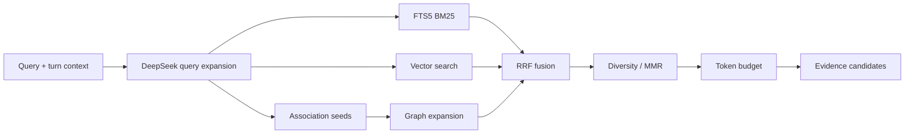
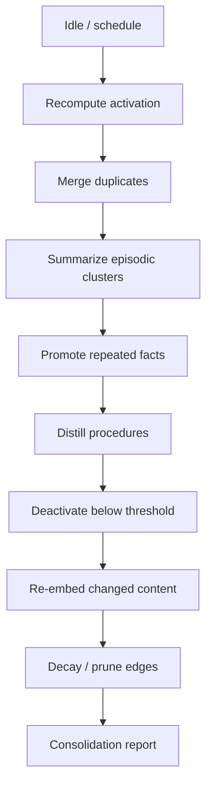
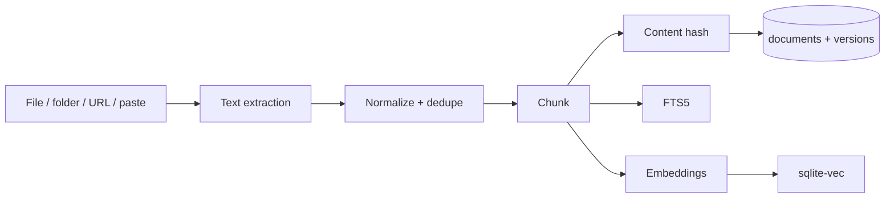
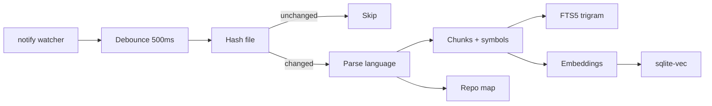

# 06 — Memory and Knowledge

## 1. Purpose

OpenBaD remembers two kinds of things:

- **Cognitive memory** — what the user and agent have learned, decided, and
  prefer, with temporal decay and associative recall.
- **Knowledge** — documents, project references, and workspace code that can
  be retrieved with citations.

Both feed the same evidence pipeline. Neither is injected into the stable
prompt prefix; retrieval results are appended as tail evidence, so remembering
more does not invalidate the provider cache.

## 2. Memory hierarchy

| Layer | Lifetime | Store | Purpose |
| --- | --- | --- | --- |
| **Working** | One turn | In-memory `TurnContext` | Current request, selected files, tool outputs |
| **Episodic** | Session / 90 days | `session_events` + summaries | What happened, in order |
| **Semantic** | Long-lived | `engrams` | Facts, preferences, decisions, conventions |
| **Procedural** | Long-lived | `skills`, `workflows`, `engrams(procedure)` | How to do things |
| **Archival** | Permanent until deleted | Export files + compacted summaries | Audit and long-term history |

The working layer is assembled per turn. The episodic layer is the event log.
The semantic and procedural layers are the cognitive memory engine. The
archival layer is for export and recovery, not retrieval.

## 3. Engram model

```rust
pub struct Engram {
    pub id: Uuid,
    pub scope: MemoryScope,          // Global, Workspace(id), Session(id)
    pub category: EngramCategory,
    pub content: String,
    pub source: EngramSource,
    pub confidence: f32,             // 0.0..=1.0
    pub base_activation: f32,
    pub decay_rate: f32,             // d in ACT-R, default 0.5
    pub access_count: u32,
    pub created_at: Timestamp,
    pub last_accessed_at: Option<Timestamp>,
    pub is_active: bool,
    pub pinned: bool,
    pub superseded_by: Option<Uuid>,
    pub source_refs: Vec<SourceRef>, // event seq, file span, URL
    pub metadata: serde_json::Value,
}
```

### 3.1 Categories

| Category | Example |
| --- | --- |
| `fact` | "The service uses PostgreSQL 17." |
| `preference` | "User prefers small, reviewable diffs." |
| `decision` | "We chose SQLite for the local working store instead of Postgres." |
| `experience` | "The migration failed on SQLite 3.44 due to FTS5 tokenizer syntax." |
| `procedure` | "Release: run tests, bump version, tag, push." |
| `reference` | "Architecture decisions live in docs/adr/." |
| `relationship` | "The gateway owns auth; the harness never sees tokens." |
| `convention` | "All public Rust functions have doc comments." |
| `code_pattern` | "Errors use thiserror in domain crates and anyhow at the app edge." |
| `bug_lesson` | "Do not hold a SQLite write transaction across an await." |

### 3.2 Sources

| Source | Meaning |
| --- | --- |
| `conversation` | Extracted from a turn |
| `user_explicit` | Created by the user via `remember` |
| `knowledge_ingestion` | Derived from a document |
| `workflow_execution` | Produced by a workflow |
| `system_observation` | Inferred by maintenance |
| `import` | Imported from another machine/session |

## 4. ACT-R activation

Base-level activation follows ACT-R:

$$
B_i = \ln\left(\sum_{j=1}^{n} t_j^{-d}\right)
$$

where `t_j` is the time since the `j`-th access (seconds) and `d` is the decay
rate.

```rust
pub fn base_level_activation(
    access_times: &[Timestamp],
    now: Timestamp,
    decay: f32,
) -> f32 {
    if access_times.is_empty() {
        return f32::NEG_INFINITY;
    }
    let sum: f64 = access_times
        .iter()
        .map(|t| {
            let seconds = (now - *t).num_seconds().max(1) as f64;
            seconds.powf(-(decay as f64))
        })
        .sum();
    (sum.max(f64::MIN_POSITIVE)).ln() as f32
}
```

Properties:

- Recent accesses dominate.
- Repeated accesses raise the baseline logarithmically.
- Neglected memories decay smoothly.
- Retrieval threshold (default `-2.0`) deactivates engrams only after a grace
  period (default 30 days) and never deletes pinned memories.

Activation is recomputed lazily on retrieval and in the consolidation job. The
stored value is a cache; access times are authoritative.

## 5. Hebbian associations

When two engrams are retrieved together and both contribute to a useful
outcome, their association strengthens:

$$
w_{ij} \leftarrow w_{ij} + \eta \cdot a_i \cdot a_j
$$

with a decay toward zero for unused edges and a cap (default `1.0`).

- Edges are directed but retrieval traverses both directions with a weight
  penalty.
- Co-retrieval is recorded only for engrams that appear in the final evidence
  set, not every candidate.
- Association expansion is bounded: at most 2 hops and 20 candidates.

## 6. Hybrid retrieval

### 6.1 Signals

| Signal | Source | Weight (default) |
| --- | --- | --- |
| BM25 | FTS5 over engram content | 1.0 |
| Vector similarity | `engram_vec` cosine | 1.0 |
| ACT-R activation | Computed | 0.6 |
| Association | Graph expansion | 0.4 |
| Confidence | Stored | 0.3 |
| Recency | `created_at` / `last_accessed_at` | 0.2 |

Weights are configurable per workspace.

### 6.2 Fusion

Use reciprocal rank fusion (RRF) for robustness across incompatible scores:

$$
\text{score}(d) = \sum_{r \in R} \frac{1}{k + \text{rank}_r(d)}
$$

with `k = 60`. The final score is the RRF score multiplied by
`(1 + activation_weight * normalized_activation)` and
`(1 + confidence_weight * confidence)`. The exact formula is recorded with each
retrieval for explainability.

### 6.3 Pipeline



1. Expand the query with identifiers, file paths, error codes, and synonyms.
   A cheap `deepseek-flash` auxiliary call handles ambiguous natural-language
   queries; deterministic expansion handles code identifiers.
2. Run BM25 and vector search in parallel.

> **Current implementation.** Project retrieval in migration
> `0006_project_areas` uses deterministic FTS5 terms over knowledge chunks,
> indexed code, and durable memories, then fuses the ranked lists with RRF
> (`k = 60`). Query expansion, vectors, reranking, MMR, and the explain panel are
> designed here but not yet enabled. See
> [Project Areas and the Split Workspace](11-project-areas-and-split-workspace.md).
3. Seed graph expansion from the top 5 results.
4. Fuse with RRF.
5. Optionally rerank the top 30 candidates with `deepseek-flash` when the query
   is ambiguous and the budget allows.
6. Diversify with MMR (lambda 0.7) to avoid near-duplicates.
7. Fit within the retrieval budget (default 4k tokens).
8. Return each result with a score breakdown.

### 6.4 Explainability

Every retrieval returns:

```json
{
  "engram_id": "...",
  "content": "...",
  "activation": -0.42,
  "bm25_rank": 3,
  "vector_rank": 1,
  "association_rank": null,
  "confidence": 0.9,
  "final_score": 0.031,
  "why": "Vector rank 1, BM25 rank 3, activation -0.42, confidence 0.9"
}
```

The UI shows this in an "Explain" panel.

## 7. Extraction pipeline


Rules:

- Extraction runs asynchronously after the turn; it never blocks the response.
- The extraction model is `deepseek-flash` with thinking disabled (or `low`),
  on an auxiliary route. This is cheap and keeps the main conversation series
  cache-stable.
- Input is the turn transcript plus tool results, with secrets redacted.
- Output is strict JSON: `[{ content, category, confidence, scope, source_refs }]`.
- Candidates below `0.55` confidence are discarded.
- Dedupe: same category + scope + cosine ≥ 0.92 → merge, keep the higher
  confidence and union source refs.
- Conflicts: a newer high-confidence memory supersedes an older one by setting
  `superseded_by`; the old memory remains auditable but is not retrieved.
- User-explicit memories are never auto-superseded; the user is asked.

### 7.1 What not to remember

- Secrets, tokens, passwords, private keys.
- Transient command output that is already in the event log.
- Unverified model speculation.
- Content the user marked "do not remember".
- Other workspaces' data.

## 8. Consolidation ("sleep")

Triggered when idle, nightly, or manually.



| Step | Rule |
| --- | --- |
| Decay | Recompute base activation; deactivate below threshold after grace |
| Dedupe | Merge near-identical engrams; union sources |
| Summarize | Cluster episodic engrams with `deepseek-flash` (off-peak) |
| Promote | A fact repeated ≥ 3 times across sessions becomes semantic |
| Procedures | Successful repeated tool sequences become procedure engrams |
| Prune | `is_active = 0`; never delete pinned or user-created |
| Re-embed | Only if content changed or model changed |
| Associations | Decay unused edges; delete below `0.01` |

Consolidation never deletes events. It can archive engrams by writing an export
artifact before deactivation. Summarization and extraction calls are scheduled
off-peak whenever possible.

## 9. Knowledge library

### 9.1 Structure

```text
Project
└── Knowledge document (content hash)
    └── Chunk (sequence + citation locator)
```

- **Project** — the hard retrieval boundary. Every document and chunk carries
  its `workspace_id`.
- **Document** — a note or imported UTF-8 file with a BLAKE3 content hash,
  tags, kind, source, and timestamps.
- **Chunk** — roughly 1,400 characters with 160 characters of overlap,
  addressed as `document_id#seq` for citations.

Collections, document versions, and heading paths remain planned extensions.

### 9.2 Ingestion



Supported formats in the current desktop build:

| Format | Extractor |
| --- | --- |
| Markdown, text, code | Native UTF-8 import or pasted note |
| PDF | Planned: `pdf-extract` (text layer) |
| DOCX | Planned: `docx-rs` |
| HTML | Planned: Fetch API (Markdown) or local readability |
| CSV/TSV | Planned: header-aware rows |
| JSON/YAML/TOML | Planned: pretty-printed text |

For URLs, the DeepSeek Fetch API returns Markdown directly, which preserves
structure and produces a clean citation. Local extraction remains available
when the user prefers not to send a document to the API.

Rules:

- Re-ingesting an unchanged content hash is a no-op.
- A changed document creates a new version; old versions remain for audit.
- Only the latest version is indexed for retrieval by default.
- Binary and scanned PDFs without a text layer are flagged, not silently
  indexed.
- Max file size default 50 MB; max document tokens default 2M.

### 9.3 Chunking

- **Documents:** current implementation splits at roughly 1,400 characters
  with 160 characters of overlap, preferring newline boundaries; future work
  will split on headings and keep heading paths.
- **Code:** split on tree-sitter nodes (functions, classes, impls); fall back
  to line windows; keep symbol name and line range.
- **Tables:** keep the header with each row group.
- Every chunk has a content hash for dedupe.

## 10. Workspace indexing

### 10.1 Discovery

Use the `ignore` crate so `.gitignore`, `.git/info/exclude`, and global Git
ignores are respected. Additional ignores:

- `.git/`, `node_modules/`, `target/`, `dist/`, `build/`, `.venv/`
- binary files, minified files, lockfiles over 2 MB
- generated files detected by header or path

### 10.2 Pipeline



- Initial index is bounded and resumable.
- Incremental indexing updates only changed files.
- Deleting a file removes its chunks from FTS and vectors.
- Indexing runs on a low-priority worker and pauses during active turns.
- A workspace fingerprint is the hash of the index manifest; it is part of the
  request envelope but changes only on explicit refresh.

## 11. Embeddings

| Concern | Decision |
| --- | --- |
| Default model | Local ONNX `nomic-embed-text-v1.5` (768 dims) |
| Why not DeepSeek | DeepSeek does not expose an embeddings endpoint today |
| Future | If DeepSeek adds embeddings, make it the default route and re-embed in the background |
| Optional | A secondary provider embeddings route |
| Batching | 32–64 chunks per request |
| Cache | Content hash → embedding; skip unchanged |
| Model change | New vector table, background re-embed, atomic alias swap |
| Dimensions | Fixed per database generation; mixed vectors are rejected |

Embedding is optional for FTS-only mode. The app still works without a model;
semantic recall degrades gracefully.

## 12. Citations and evidence

Every knowledge or memory result carries a citation:

```rust
pub struct Citation {
    pub source_type: SourceType,
    pub source_name: String,
    pub locator: Locator,       // path + lines, URL, doc id + chunk
    pub quote: String,
    pub observed_at: Timestamp,
}
```

- File citations link to the editor at the exact line range.
- Document citations link to the knowledge viewer and highlight the chunk.
- Memory citations show the engram and its source event.
- The evidence gate rejects a citation without a locator.

## 13. Scoping and privacy

| Scope | Visible to | Example |
| --- | --- | --- |
| Global | All workspaces | "User prefers concise diffs" |
| Workspace | One workspace | "This repo uses SQLx" |
| Session | One session | "We are mid-migration" |

Rules:

- Retrieval always filters by scope and workspace.
- Cross-workspace memory is never retrieved, even if semantically similar.
- The user can pin, edit, forget, or export any memory.
- "Forget" deactivates and removes embeddings; an audit tombstone remains.
- Secrets are never stored; the redaction pass runs before extraction.

## 14. UI

### Split project panel

The desktop UI keeps the conversation primary and opens project areas on the
right. In the current build:

- **Memory** — pinned and recent project memories with forget actions.
- **Knowledge** — filter, open, add notes, import UTF-8 files, and delete.
- **Workspace** — filter indexed files and open them as artifacts.
- **Repos** — link read-only repositories and remove them.
- **Retrieval** — query the fused corpus and inspect citations.
- **Edits / Diag** — checkpoints and diagnostics without permanent chrome.

Future refinements include retrieval score explanations, ingestion queues,
chunk viewers, and repository file browsing.

## 15. Evaluation

| Metric | Target |
| --- | --- |
| Retrieval recall@10 (fixtures) | ≥ 0.85 |
| MRR (fixtures) | ≥ 0.70 |
| Retrieval p95 latency | < 50 ms |
| Extraction precision (human review sample) | ≥ 0.80 |
| Duplicate rate after consolidation | < 2% |
| Citation accuracy | 100% (no citation without locator) |
| Index throughput | 10k files < 60 s |

Fixtures live in `tests/fixtures/memory/` and `tests/fixtures/knowledge/`.
Evaluation runs in CI on every change to scoring or extraction.

## 16. Configuration defaults

```toml
[memory]
enabled = true
activation_threshold = -2.0
decay_rate = 0.5
grace_days = 30
retrieval_top_k = 12
retrieval_token_budget = 4096
extraction_confidence_floor = 0.55
extraction_model = "deepseek-flash"
extraction_thinking = "disabled"
consolidation_idle_minutes = 10
consolidation_model = "deepseek-flash"

[knowledge]
chunk_tokens = 800
chunk_overlap = 0.12
max_file_mb = 50
embedding_model = "nomic-embed-text-v1.5"
embedding_dimensions = 768

[workspace_index]
max_files = 250_000
max_file_mb = 2
debounce_ms = 500
```

## 17. Related documents

- [Data Model and Storage](03-data-model-and-storage.md)
- [Agent Runtime and Tools](05-agent-runtime-and-tools.md)
- [Autonomic System and Governance](07-autonomic-system-and-governance.md)
