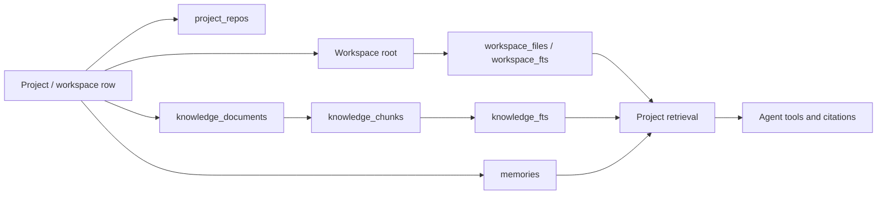

# 11 — Project Areas and the Split Workspace

## 1. Why a project is more than a folder

A coding agent needs more than a root directory. It needs the code it may edit,
references it may only read, durable decisions, curated documents, and a way to
show the user what it found. OpenBaD therefore treats a **project** as a
container with six project-scoped areas:

| Area | Purpose | Default access |
| --- | --- | --- |
| Chat | Conversation and agent turns | session-scoped |
| Workspace | The project's single managed directory | read/write by access mode |
| References | Additional folders selected by the user | read-only |
| Knowledge | Curated notes and imported references | read/write in project |
| Retrieval | Inspect the fused project corpus | read-only |
| Memory | Durable decisions and preferences | read/write in project |

Every row is keyed by `workspace_id`. Nothing from one project appears in
another project's list, retrieval set, or agent context.



## 2. Storage model

Migration `0006_project_areas` adds the project areas; migration
`0007_knowledge_confidence` extends knowledge documents with `confidence` and
`source_hash`. Together they add:

- `project_repos` — read-only reference folders,
  `(id, workspace_id, name, path, read_only, created_at)`, unique per
  `(workspace_id, path)`.
- `knowledge_documents` — project-owned document metadata, full content, tags,
  BLAKE3 content hash, confidence label, optional source hash, timestamps.
- `knowledge_chunks` — ordered chunk rows owned by a document.
- `knowledge_fts` — FTS5 index over chunk content, carrying workspace and
  document identity so retrieval can be scoped and cited.

Project truth lives in `.openbad/canon.yaml`, `.openbad/glossary.yaml`, and
`.openbad/adr/`; `yaml_query` gives bounded access to project YAML documents
without loading whole files.

Claims and known unknowns live in `.openbad/claims.json` and
`.openbad/unknowns.json`; both are injected into the next prompt.

Plan mode lives in `.openbad/plan.json`; drafts are approved in Project → Plan
and steps carry executable `verify_with` checks.

Structured questions live in `.openbad/questions.json` and are answered in the
Project → Questions panel. The assistant reads the answer on its next turn.

`.openbad/context.yaml` pins files that should stay resident and excludes paths
that must never load. `.openbad/dead-ends.json` records negative knowledge so a
later session does not repeat a ruled-out search.

A sibling `.openbad/permissions.yaml` can restrict writes and command classes.
It is reviewable policy, not prompt discipline: tools check it before mutating
files or spawning commands and return the specific rule that blocked the action.

Optional capabilities live under `.openbad/plugins/<name>/`. Each plugin has a
`plugin.yaml`, an entrypoint, and optionally a `SKILL.md`; it exchanges one JSON
request/response over stdin/stdout and runs under the same command policy and
timeout rules. Run evidence goes to `.openbad/plugin-runs/`. The assistant can
scaffold, edit, test, and call plugins, and the bundled AsciiDoc plugin is
installed with `plugin_install_builtin` rather than adding a mandatory
`asciidoctor` dependency to the desktop build.

Recipes may target reference folders with an absolute `cwd`; named runners
allow that explicitly. Invariant `check: manual` is attested, not executed.
Canon lint supports fenced-code skipping, off markers, and `paths_ignore`.

Verification `gates:` group those recipes into named checklists. `run_gate`
records evidence under `.openbad/gates/`; `prove_it: true` turns unverified
claims into explicit labels.

Project manifests also declare a `recipes:` registry for verification
(lint/test/build/schema commands) and `validators:` glob/command pairs. Writes
matching a validator run it before the result is accepted; failures roll the
file back to its previous content.

Knowledge notes are typed and reviewed (proposed/accepted/rejected); a
`supersedes` relation keeps an audit trail while removing the old note from
retrieval. `export_knowledge`/`import_knowledge` round-trip Markdown under
`knowledge/` with frontmatter.

Knowledge writes are transactional: the document, its chunks, and its FTS rows
are inserted together. Imported files record the source path and a BLAKE3
source hash so later reads can flag stale notes; notes accept `verified`,
`inferred`, or `uncertain` confidence. Deleting a document removes its FTS rows before the
document cascade. Identical content in the same project is idempotent and
returns the existing document.

### Chunking

Documents are split at roughly 1,400 characters with 160 characters of overlap,
preferring newline boundaries after the first third of the window. Chunk
identity is `(document_id, seq)`, which becomes the citation locator
`document_id#seq`.

### Managed workspace

A project owns exactly one workspace. New projects require only a name:
OpenBaD resolves the default workspaces directory (`~/OpenBaD/workspaces`,
overridable with `OPENBAD_WORKSPACES_DIR`), creates a unique slug directory,
and records that path as the project workspace. Existing workspace paths remain
supported for projects created before managed workspaces.

### Reference folders

References are selected with the native folder picker. A reference is
canonicalized when added. The agent's `read_repo_file` tool canonicalizes both
the reference root and the requested path, then requires the requested path to
stay under the root. References are read-only. Users can remove a reference
without deleting the directory.

## 3. Retrieval

`retrieve_project` is the single retrieval entry point used by the UI and the
agent. It searches three sources independently:

1. **Knowledge** — FTS5 `MATCH` over `knowledge_fts`, scoped by `workspace_id`.
2. **Code** — FTS5 `MATCH` over the existing `workspace_fts` index.
3. **Memory** — durable, non-forgotten memories matching the query, with
   pinned entries ordered first.

Results are merged with reciprocal rank fusion (`1 / (60 + rank)`) so that
different FTS rank scales stay comparable. Each hit carries:

- `source` — `knowledge`, `code`, or `memory`
- `title`
- `snippet` with `<<` / `>>` relevance markers where available
- `locator` — `document#chunk`, workspace path, or memory id
- `score`

The model-facing `search_project` tool prints locators so answers can cite what
they used. Embedding-backed semantic retrieval can later replace the ranking
stage without changing the project model, locator contract, or tools.

## 4. Agent tools

| Tool | Risk | Contract |
| --- | --- | --- |
| `list_project_sources` | read | List reference folders and knowledge documents. |
| `search_project` | read | Fuse knowledge, indexed code, and memory; return citable locators. |
| `list_repo_dir` | read | List a reference folder with sizes and `.gitignore` filtering. |
| `glob_repo` | read | Find reference files by glob. |
| `grep_repo` | read | Search reference text; case-insensitive by default. |
| `read_repo_file` | read | Read a bounded region with total-line and continuation metadata. |
| `add_knowledge` | write | Add a curated note with a confidence label. |
| `read_project_manifest` | read | Read purpose, scope map, commands, and invariants. |
| `classify_path` | read | Classify a path against the project scope map. |
| `run_task` | command | Run a named manifest command; Full access only. |
| `todo_write` / `todo_read` | write/read | Maintain durable project todos. |
| `write_handoff` | write | Write a session handoff beside project state. |
| `present_artifact` | read | Open a web page, image, markdown note, diff, or file beside chat. |

`ToolContext` carries an optional `ProjectAreas` implementation. The desktop
shell backs it with the SQLite store and the active workspace id. Tool results
carry a `metadata` value; `present_artifact` uses
`metadata.openbad_artifact` to request the split pane.

The agent system prompt tells the model that project knowledge is separate from
code, to call `search_project` before answering questions that may depend on
earlier decisions or imported references, and to cite returned locators.

## 5. Split workspace

The desktop layout is intentionally conversation-first:

```text
┌──────────────────────────────────────────────────────────────────┐
│ menu bar: File · Edit · View · Project · Help                    │
├──────────┬────────────────────────────┬──────────────────────────┤
│ project  │ chat                       │ project panel / artifact │
│ sidebar  │ messages + composer        │ resizable, closable      │
└──────────┴────────────────────────────┴──────────────────────────┘
```

- The application menu bar carries project-wide actions and a View menu that
  opens every project area, so the header can stay focused on breadcrumbs and
  status.
- The project sidebar exposes Overview, Workspace, References, Knowledge,
  Retrieval, and Memory links beneath the active project.
- Selecting an area opens it on the right without hiding the conversation.
- The panel is resizable with a 320 px floor and a viewport-aware ceiling.
- On narrow windows the full sidebar collapses when the panel opens so chat
  keeps a usable width.
- The panel tabs include Edits (checkpoints) and Diagnostics for operations that
  do not deserve permanent chrome.
- While open, project areas poll for changes and also refresh after turns,
  checkpoint restores, and knowledge/reference mutations. Open artifacts reload
  without clearing the pane.
- Files, knowledge documents, and retrieval hits open as artifacts in the same
  panel. The assistant can open one with `present_artifact`.

### Artifact kinds

| Kind | Rendering |
| --- | --- |
| `web` | Sandboxed iframe with an external-open link |
| `image` | Inline image, including workspace files read as data URLs |
| `markdown` | GitHub-flavored Markdown |
| `diff` | Line-colored unified diff |
| `file` | UTF-8 text from the workspace |

Workspace previews are resolved through `WorkspaceService`, capped at 8 MiB,
and returned as either UTF-8 text or a data URL. Knowledge artifacts load by
`knowledge:<document_id>`. Artifacts are currently a view concern; persisting
their history across restarts is follow-up work.

## 6. Failure modes

- **Reference folder escapes its root** — rejected by canonical path
  containment.
- **Knowledge import is not UTF-8 or exceeds 4 MiB** — rejected with a clear
  error; no partial document is written.
- **Duplicate knowledge content** — returns the existing document.
- **Web page refuses framing** — the iframe may be blank; the external-open
  link remains available.
- **Preview too large** — rejected at 8 MiB.
- **Project panel open on a small screen** — the sidebar collapses to protect
  the chat width.
- **Store write fails** — mutation surfaces in the panel error region and the
  local list is only updated after the backend succeeds.

## 7. Follow-up

1. Index reference folders into the same retrieval model with a `reference`
   source and reference-relative locators.
2. Persist artifact history and restore the most recent artifact when a session
   reopens.
3. Add embedding-backed hybrid retrieval and explainable score breakdowns.
4. Add a native folder picker for knowledge import.
5. Add file watching so workspace and reference panels reflect changes without
   a manual index refresh.
6. Add per-area access policy, especially write access to reference folders.

## 8. Verification

- Store tests cover project scoping, idempotent knowledge writes, chunking,
  retrieval, deletion, and overview counts.
- Tool tests cover search, knowledge add, reference-folder reads, path escape
  rejection, source listing, and artifact metadata.
- Agent tests verify tool metadata reaches the observer.
- Playwright covers project creation, reference folders, project knowledge,
  retrieval, and assistant-presented artifacts in the split workspace.
