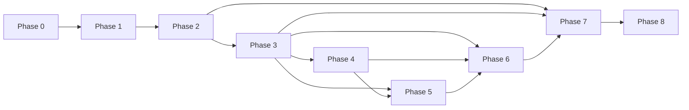

# 0001 — Implementation Plan

## 1. Objective

Deliver OpenBaD Desktop v1.0: a DeepSeek-first, cache-first coding harness for
Linux, macOS, and Windows, built in Rust with Tauri v2 and React, with cognitive
memory, knowledge/RAG, and autonomic governance.

The plan is organized into phases with hard acceptance criteria. Each phase
produces something usable and testable. No phase depends on unmerged work from a
later phase.

## 2. Guiding constraints

- **DeepSeek-first.** Every phase assumes DeepSeek connectivity. Local fallbacks
  are optional and never block the critical path.
- **Cache-first.** Prefix stability is a release gate, not a later optimization.
- **One source of truth.** SQLite event log; projections are derived.
- **Bounded autonomy.** Approvals, budgets, and audit from the first usable
  build.
- **Incremental delivery.** MVP after Phase 4; v1.0 after Phase 8.
- **Tests with every phase.** Unit, integration, and fixtures; real DeepSeek
  calls only in opt-in nightly jobs.

## 3. Milestones

> **Status (2026-10-19):** Phase 1 foundation is complete on Linux. The
> workspace, single-writer SQLite store, event projections, audit hash chain,
> settings, providers/routes, backup/doctor checks, secret-store abstraction,
> Tauri shell, React UI, docs checks, and CI are in place and passing. Linux
> Secret Service keychain round-trip and cross-process persistence are
> validated; macOS and Windows still need per-OS validation. Phase 2 provider
> foundation is complete, and the Phase 3 coding MVP is working: built-in
> workspace tools, the DeepSeek agent loop, SQLite message persistence, keychain
> API-key storage, and a Tauri chat UI with streamed reasoning and cancellation.
> Phase 4 has started with the SQLite workspace index and indexed search tools.
> Per-call approvals, the evidence gate, LSP/PTY, whole-turn rewind, and the
> Phase 5–8 systems remain.

| Milestone | Phases | Outcome | Target |
| --- | --- | --- | --- |
| **M0 — Reset** | 0 | Archive, docs, workspace skeleton, CI | Week 1 |
| **M1 — Foundation** | 1 | Store, migrations, config, secrets | Week 3 |
| **M2 — DeepSeek runtime** | 2 | DeepSeek adapter, prompt assembly, cache ledger, token meter | Week 6 |
| **M3 — Coding MVP** | 3–4 | Agent loop, tools, Tauri chat, workspace intelligence | Week 14 |
| **M4 — Memory and knowledge** | 5 | Engrams, RAG, library, citations | Week 18 |
| **M5 — Autonomy** | 6 | Subagents, skills, workflows, schedules, off-peak | Week 22 |
| **M6 — Hardening** | 7 | Sandbox, audit, threat-model controls | Week 24 |
| **M7 — v1.0** | 8 | Performance, packaging, beta, release | Week 27 |

## 4. Phase 0 — Reset and scaffolding

**Goal:** a clean repository that builds and tests nothing-yet, with the old
project archived and the new decisions recorded.

### Tasks

| ID | Task | Acceptance |
| --- | --- | --- |
| P0-01 | Archive v0 docs and code under `archive/openbad-v0/` | `git log --follow` preserves history; archive README explains status |
| P0-02 | Write architecture docs 00–10 and ADRs 001–007 | Docs pass link check and Mermaid validation |
| P0-03 | Create Cargo workspace with empty crates | `cargo check --workspace` succeeds |
| P0-04 | Create Tauri v2 app shell and React/Vite UI | `cargo tauri dev` opens a window |
| P0-05 | Add `rust-toolchain.toml`, `rustfmt.toml`, `clippy.toml` | `cargo fmt --check` and `cargo clippy -D warnings` pass |
| P0-06 | Add CI for fmt, clippy, test, UI lint/typecheck | CI green on an empty baseline |
| P0-07 | Add `cargo deny` and `pnpm audit` | License policy enforced |
| P0-08 | Add issue templates and labels | New issues use the template |

### Acceptance criteria

- `cargo check --workspace` and `pnpm typecheck` pass.
- CI runs on PRs and `main`.
- The app launches with a placeholder view.
- The archive is readable and the new docs are indexed.

### Risks

- Tauri system dependencies on Linux (WebKitGTK). Mitigation: document packages
  and provide a dev container or setup script.

## 5. Phase 1 — Core domain and store

**Goal:** a durable, tested foundation for sessions, events, settings, and
secrets.

### Tasks

| ID | Task | Acceptance |
| --- | --- | --- |
| P1-01 | `openbad-core`: IDs, errors, clock, domain events, config types | Table-driven tests; no IO |
| P1-02 | `openbad-store`: SQLite pool, writer actor, migrations | Migrations apply to empty DB; schema hash test |
| P1-03 | Implement `session_events` + projections | Append/replay tests; projection rebuild equals live |
| P1-04 | Implement workspaces, sessions, settings, providers, routes | CRUD tests; foreign keys enforced |
| P1-05 | Implement audit log with hash chain | Tamper detection test |
| P1-06 | Keychain integration for API keys | Key stored/retrieved/cleared on all platforms |
| P1-07 | Backup/restore and `PRAGMA integrity_check` | Restore test; corrupt DB handled |
| P1-08 | `doctor` skeleton | Reports versions and DB health |

### Acceptance criteria

- 100% of migrations are covered by tests.
- Event append is atomic with projection updates.
- Replay from events reproduces projections byte-for-byte.
- Keys never appear in the DB or logs.
- Full test suite runs in < 60 s.

### Tests

- Unit: IDs, canonical JSON, error mapping.
- Integration: append/replay, backup/restore, keychain mock.
- Property: `seq` monotonicity; projection idempotence.

### Implementation notes

- `openbad-store::Store` owns a dedicated writer thread and a separate reader
  connection. Every mutation goes through `WriteCommand`; event append and
  projection update share one transaction.
- `0004_file_checkpoints.sql` adds file snapshots for restore-on-demand.
- `0003_workspace_index.sql` adds workspace file hashes, symbols, and FTS5 search.
- `0002_phase1_schema.sql` adds providers, model routes, session projections,
  approvals, audit, LLM calls, tool invocations, evidence, and request
  envelopes. `session_events` remains the source of truth.
- `audit_log` is a BLAKE3 hash chain. `audit_verify` reports the first invalid
  record on tamper.
- Backup uses `VACUUM INTO`; `Store::restore_from` validates
  `PRAGMA integrity_check` before copying over an offline target.
- `openbad-governance` defines `SecretStore`, `MemorySecretStore` for tests, and
  a `KeychainSecretStore` behind the optional `keyring` feature. Linux Secret
  Service round-trip and cross-process persistence are validated by the
  `keychain_roundtrip` example; macOS and Windows validation is still pending.
- The Tauri `foundation` command exposes doctor metrics, audit state, providers,
  and model routes to the Phase 1 UI.

## 6. Phase 2 — DeepSeek runtime

**Goal:** a cache-aware provider layer with accurate usage, cost, and token
accounting.

### Tasks

| ID | Task | Acceptance |
| --- | --- | --- |
| P2-01 | `ModelProvider` trait and capability model | Contract tests for all capability flags |
| P2-02 | DeepSeek adapter: chat, streaming, thinking, tools | Mock + real nightly tests; reasoning passback |
| P2-03 | DeepSeek adapter: Files, Search, Fetch, Balance | Contract tests; file cache by hash |
| P2-04 | FIM and chat prefix completion (beta) | Separate series; validation tests |
| P2-05 | Usage normalization and cost ledger | DeepSeek hit/miss mapping; peak/off-peak |
| P2-06 | Prompt section registry and canonical assembly | Determinism tests; volatile lint |
| P2-07 | Request envelope and series guard | New series on model/thinking/tool change |
| P2-08 | Token meter and per-node pricing | Accuracy vs. provider usage within tolerance |
| P2-09 | Compaction policy and prefix-preserving summarizer | Prefix equality test; cache reset recorded |
| P2-10 | Cache meter UI (headless data first) | Cache hit %, cost, reset reasons |
| P2-11 | Retry executor with frozen requests | Byte-identical retries |
| P2-12 | Off-peak pricing calendar | Correct peak/off-peak per timestamp |

### Acceptance criteria

- A 10-turn fixture preserves the prefix on every turn.
- Retries are byte-identical.
- Compaction summarizer reuses the prefix.
- DeepSeek usage fields map correctly.
- Cost reports match hand-computed fixtures.
- Thinking on/off and effort changes start a new series.
- No volatile data in stable sections.

### Tests

- Request-byte golden files for fixtures.
- Mock SSE streams for thinking, tools, and errors.
- Nightly real DeepSeek cache test with a capped budget.
- Peak/off-peak pricing table tests.

### Phase 2 implementation notes

- `openbad-llm` now has a `DeepSeekClient` over an `HttpTransport` seam. The
  reqwest transport is the production default; tests use an in-process mock
  transport.
- `ChatRequest` freezes deterministic request bytes, preserves
  `reasoning_content` verbatim, validates object-shaped tool arguments, and
  supports prefix-completion validation.
- `DeepSeekStreamDecoder` parses split SSE chunks, reasoning deltas, tool-call
  deltas, usage, and `[DONE]`.
- `RawUsage::normalize` maps DeepSeek disjoint hit/miss counters and
  OpenAI-style `cached_tokens` into the shared `Usage` shape.
- `openbad-llm::pricing` contains the current flash/pro off-peak and peak
  prices, the 01:00–04:00 and 06:00–10:00 UTC weekday calendar, holiday
  overrides, and per-session `UsageTotals`.
- `SeriesGuard` reports the first cache-breaking field change. `RetryPolicy`
  retries 408/429/5xx and transport failures with capped exponential backoff;
  retries reuse the frozen request bytes.
- FIM requests are validated against the `/beta` constraints: flash only,
  4K output ceiling, and non-empty prompt.

## 7. Phase 3 — Agent runtime, tools, and chat UI

**Goal:** a usable coding assistant that can answer, search, edit, and run
commands with approvals.

### Tasks

| ID | Task | Acceptance |
| --- | --- | --- |
| P3-01 | Turn/step state machine and event vocabulary | Replay and cancellation tests |
| P3-02 | Router with dual-process table | Fixture accuracy; safe fallback |
| P3-03 | Tool registry, schemas, strict mode, pipeline | Contract tests for every tool |
| P3-04 | File tools: read/write/edit/patch | Read-before-write; atomic patch; path containment |
| P3-05 | Search tools: grep/glob/repo map/symbols | Bounded results; `.gitignore` respected |
| P3-06 | Evidence contract and gate | Acceptance/rejection fixtures |
| P3-07 | Approval policy and HITL | Risk matrix; pause/resume |
| P3-08 | Tauri chat UI: streaming, tool cards, citations | E2E with mock provider |
| P3-09 | Session resume, fork, search, title | Replay tests; FTS search |
| P3-10 | DeepSeek Search/Fetch tools | Citations; allowlist; error handling |
| P3-11 | Secret redaction and injection markers | Fixtures pass |
| P3-12 | Budgets and cancellation | Graceful stop; no orphan processes |

### Acceptance criteria

- A user can open a folder, ask a question, get cited file spans, request an
  edit, review the diff, approve it, and see the file change.
- A denied approval produces a recoverable tool error.
- A cancelled turn leaves a resumable session.
- The evidence gate rejects unsupported claims in fixtures.
- The chat UI streams tokens and shows token/cache/cost.

### Tests

- E2E: open workspace → ask → read → edit → approve → diff.
- Tool contract matrix.
- Approval matrix.
- Evidence gate fixtures.
- Cancellation and orphan-process tests.

### Phase 3 implementation notes

- `openbad-tools` now has a `Tool` trait, a `ToolRegistry`, OpenAI-style tool
  schemas, and thirteen built-in tools: `read_file`, `list_dir`, `grep`,
  `search_code`, `glob`, `find_symbols`, `write_file`, `edit_file`,
  `run_command`, `run_tests`, `git_status`, `git_diff`, and `repo_map`.
- All filesystem tools resolve through `WorkspaceService`, which canonicalizes
  paths and rejects parent or symlink escapes. Existing files must be read before
  they can be overwritten or edited. Writes use a temporary file plus rename.
- `openbad-agent` runs the DeepSeek turn/step loop, accumulates usage and cost,
  feeds tool errors back to the model as tool messages, and enforces a 64-step
  default budget. It streams reasoning and content deltas through an
  `AgentObserver` and emits tool call/result progress.
- The Tauri `chat` command connects the agent to the SQLite store, persists
  user/assistant/tool messages, records usage, and streams agent events over a
  Tauri channel. The React UI shows live reasoning, response text, tool progress,
  token/cache/cost, workspace chat, API-key settings, write/command toggles,
  recent-session resume, and store diagnostics.
- New sessions reuse the workspace row by path. The chat panel has bounded
  height and follows new content unless the user scrolls up.
- `ui/src/backend.ts` provides a browser mock backend when Tauri internals are
  absent, so streaming, scrolling, and layout can be tested in a normal browser
  without rebuilding the native app.
- The chat settings expose `deepseek-flash` vs `deepseek-v4-pro`, thinking mode,
  reasoning effort, and the step budget. A Stop button cancels the active turn.
  Usage lines show cache-hit share, and resumed sessions restore reasoning.
- Recent sessions can be searched by title or message text from the sidebar.
  The store uses a literal `LIKE` search with escaped wildcards, and the UI
  debounces input before querying.
- The desktop build enables the `keyring` feature by default; `DEEPSEEK_API_KEY`
  and `OPENBAD_DEEPSEEK_BASE_URL` remain available for headless or mock runs.
- `run_tests` detects Cargo, pnpm/npm/yarn, pytest, Go, and make projects,
  runs the suite through the gated command tool, and surfaces failure summary
  lines.
- `run_command` drains stdout/stderr concurrently, runs the shell in its own
  process group, and kills the whole group on timeout or exit so background
  helpers do not survive the call.
- Tool execution is currently gated by session-wide write/command toggles.
  Tool output is redacted against the active provider key before it reaches the
  model, observer, or session trace. Per-call approval cards remain follow-up
  work.

## 8. Phase 4 — Workspace intelligence

**Goal:** make the harness genuinely useful on real repositories.

### Tasks

| ID | Task | Acceptance |
| --- | --- | --- |
| P4-01 | Workspace indexer with `ignore`, hashing, debounce | 10k files < 60 s; incremental < 2 s |
| P4-02 | FTS5 code search + symbol index | Recall fixtures; p95 < 50 ms |
| P4-03 | LSP manager (stdio, lifecycle, diagnostics) | Rust/TS/Python smoke tests |
| P4-04 | Shell/PTY and job supervisor | Process group kill; background jobs |
| P4-05 | Git read tools and approval-gated writes | Status/diff/log; commit/push tests |
| P4-06 | Test runner and failure triage | Parse Rust/JS/Python output |
| P4-07 | Diff viewer, hunk actions, checkpoint/rewind | Rewind restores only edited files |
| P4-08 | Editor with FIM inline completion | Ghost text; accept/reject; separate series |
| P4-09 | Prefix-completion constrained edit flow | Validation and retry |
| P4-10 | Workspace fingerprint and explicit refresh | Series reset only on refresh |
| P4-11 | `openbad doctor` workspace report | Index/LSP/Git diagnostics |

### Acceptance criteria

- Open a 10k-file repository and answer a symbol question in < 2 s after index.
- Edit a file, see a diff, run tests, and rewind to the checkpoint.
- Inline completion appears within 500 ms for a small file.
- LSP diagnostics appear in the Problems panel.
- Background jobs can be listed and cancelled.

### Tests

- Index throughput and incremental update benchmarks.
- LSP smoke tests with fixture servers.
- PTY/job kill tests.
- Diff/rewind integration tests.
- FIM mock tests.

### Phase 4 implementation notes

- `openbad-index` walks the workspace with `ignore`, hashes file contents with
  BLAKE3, and stores changed files, symbols, and full text in SQLite. Unchanged
  files are skipped on refresh, and deleted files are removed from the index.
- `0003_workspace_index` adds `workspace_files`, `workspace_symbols`, and an
  FTS5 `workspace_fts` table. Indexed search returns snippets and symbol
  locations; `search_code` and `find_symbols` use the index when the desktop
  supplies it and fall back to live scans otherwise.
- The desktop automatically indexes an empty workspace and exposes a Workspace
  index panel with file/symbol counts and a refresh action. Indexing runs on a
  blocking task so the chat UI stays responsive.
- Default indexing limits are 512 KiB per file and 64 directory levels. The
  extension allowlist covers common source, config, and documentation formats;
  binary files are skipped.
- `write_file` and `edit_file` save the original file (or its absence) to
  `file_checkpoints` before mutating. The sidebar lists recent checkpoints,
  renders a unified diff against the current file, and can restore them; restore
  resolves the path back inside the session workspace and deletes the used
  checkpoint.
- Still open for Phase 4: filesystem watching/debounce, LSP diagnostics, PTY and
  job supervision, whole-turn rewind, FIM completion, and the workspace doctor
  report.

## 9. Phase 5 — Memory and knowledge

**Goal:** durable project memory and grounded knowledge retrieval.

### Tasks

| ID | Task | Acceptance |
| --- | --- | --- |
| P5-01 | Engram CRUD, scopes, categories, pin/forget | Scope isolation tests |
| P5-02 | ACT-R activation and decay | Formula tests; deterministic clock |
| P5-03 | Hebbian associations | Co-retrieval and decay tests |
| P5-04 | Hybrid retrieval with RRF + explain | Recall@10 and MRR targets |
| P5-05 | DeepSeek extraction pipeline | JSON schema; confidence floor; dedupe |
| P5-06 | Knowledge collections/documents/versions | Versioning and re-ingest tests |
| P5-07 | Ingestion: markdown, code, PDF, DOCX, HTML | Format fixtures |
| P5-08 | Embeddings (local default, optional provider) | Model-swap migration test |
| P5-09 | Citations in chat and knowledge viewer | Every citation has a locator |
| P5-10 | Consolidation ("sleep") and report | Dedupe, promote, prune tests |
| P5-11 | Memory/knowledge UI | Search, explain, forget, ingest |

### Acceptance criteria

- A decision made in session A is recalled in session B for the same workspace.
- A knowledge document answer cites the exact chunk and heading.
- Forgetting a memory removes it from retrieval.
- Consolidation reduces duplicates without deleting pinned memories.
- Retrieval p95 < 50 ms on 100k engrams (benchmark fixture).

### Tests

- ACT-R property tests.
- Retrieval quality fixtures.
- Extraction schema and dedupe tests.
- Ingestion format fixtures.
- Citation accuracy tests.

## 10. Phase 6 — Autonomy

**Goal:** bounded autonomous work with subagents, skills, workflows, and
schedules.

### Tasks

| ID | Task | Acceptance |
| --- | --- | --- |
| P6-01 | Subagent runtime and tool scopes | Depth/budget/scope tests |
| P6-02 | Plan mode and todo list | Read-only enforcement; plan approval |
| P6-03 | Goal loop with stop conditions | Budget/no-progress tests |
| P6-04 | Skills loader and index | Workspace/global precedence |
| P6-05 | Workflow engine and validation | Deterministic run tests |
| P6-06 | MCP client and stable proxy tool | Server add/remove does not change schema |
| P6-07 | Heartbeat and job supervisor | Beat cadence; crash recovery |
| P6-08 | Schedules and reminders | Missed-run policy |
| P6-09 | Pulse metrics and alerts | Threshold tests |
| P6-10 | Off-peak scheduling for background work | Peak/off-peak fixtures |
| P6-11 | Reflex hooks (format/lint/test) | Timeout and diff tests |

### Acceptance criteria

- A review subagent produces a structured report without sharing the parent's
  full context.
- A skill loads on demand; only its name/description is in the stable prompt.
- A workflow runs deterministically and stops on approval denial.
- Connecting an MCP server does not change the request prefix hash.
- Background consolidation runs off-peak when idle.

### Tests

- Subagent isolation and budget tests.
- Skill precedence tests.
- Workflow validation and failure tests.
- MCP lifecycle tests.
- Schedule and off-peak tests.

## 11. Phase 7 — Security hardening

**Goal:** make the threat model controls real and verified.

### Tasks

| ID | Task | Acceptance |
| --- | --- | --- |
| P7-01 | Injection detection and quarantine | Fixture corpus passes |
| P7-02 | Secret scanning and redaction | Fixture corpus passes |
| P7-03 | Command risk classifier | Matrix tests |
| P7-04 | Path containment and symlink checks | Escape tests |
| P7-05 | Resource limits and sandbox baseline | CPU/memory/file limits |
| P7-06 | OS sandbox adapters (optional) | Linux/macOS/Windows smoke tests |
| P7-07 | Audit chain verification and export | Tamper detection test |
| P7-08 | Data-flow/privacy settings | "No memory/web/embeddings" mode works |
| P7-09 | Threat-model review | Sign-off checklist |

### Acceptance criteria

- All fixture attacks are blocked or require approval.
- Secrets never appear in logs, prompts, or exports.
- A sandbox escape fixture fails.
- Audit tampering is detected.
- A privacy-restricted workspace sends only the minimum context.

## 12. Phase 8 — Performance, packaging, and v1.0

**Goal:** meet the performance/cost targets and ship signed installers.

### Tasks

| ID | Task | Acceptance |
| --- | --- | --- |
| P8-01 | Cache benchmark suite | Targets met |
| P8-02 | Cost benchmark vs. naive harness | −40% or better |
| P8-03 | Latency benchmarks | Budgets met |
| P8-04 | SQLite query tuning | p95 < 10 ms |
| P8-05 | UI performance | Startup/streaming targets |
| P8-06 | Installers for Linux/macOS/Windows | Signed, smoke-tested |
| P8-07 | Auto-update | Signed manifest; rollback |
| P8-08 | Crash reporting (opt-in) | Redacted; local viewer |
| P8-09 | Documentation and onboarding | Quickstart works |
| P8-10 | Beta program and feedback triage | Issues labeled and prioritized |

### Acceptance criteria

- All release gates in [10 — Providers, Observability, and Performance](../architecture/10-providers-observability-performance.md) pass.
- A clean machine can install and complete the quickstart.
- The app survives a provider outage, a crash, and a corrupt DB.
- Cache hit and cost targets are demonstrated on fixtures.

## 13. Work breakdown by feature

| Feature | Phase | Primary tasks |
| --- | --- | --- |
| F-01 event log | 1 | P1-02, P1-03 |
| F-02 prompt assembly | 2 | P2-06 |
| F-03 cache accounting | 2 | P2-05, P2-10 |
| F-04 token meter | 2 | P2-08 |
| F-05 retry/compaction | 2 | P2-09, P2-11 |
| F-06 dual-process routing | 3 | P3-02 |
| F-07 evidence gate | 3 | P3-06 |
| F-08 agent loop | 3 | P3-01, P3-12 |
| F-09 streaming UI | 3 | P3-08 |
| F-10 session tools | 3 | P3-09 |
| F-11 file tools | 3 | P3-04 |
| F-12 search tools | 3 | P3-05 |
| F-13 shell/jobs | 4 | P4-04 |
| F-14 Git | 4 | P4-05 |
| F-15 tests/diagnostics | 4 | P4-06 |
| F-16 LSP | 4 | P4-03 |
| F-17 diff/checkpoint | 4 | P4-07 |
| F-18 plan/todo/goal | 6 | P6-02, P6-03 |
| F-19 subagents | 6 | P6-01 |
| F-20 skills/workflows | 6 | P6-04, P6-05 |
| F-21 MCP | 6 | P6-06 |
| F-22 web | 3 | P3-10 |
| F-23 browser/computer use | later | — |
| F-24 schedules | 6 | P6-07, P6-08 |
| F-25 engrams | 5 | P5-01..P5-04 |
| F-26 hybrid retrieval | 5 | P5-04 |
| F-27 consolidation | 5 | P5-10 |
| F-28 knowledge library | 5 | P5-06..P5-09 |
| F-29 workspace index | 4 | P4-01, P4-02 |
| F-30 operator profile | 5 | P5-01 (scope) |
| F-31 privacy | 5 | P5-01, P7-08 |
| F-32 heartbeat | 6 | P6-07 |
| F-33 pulse | 6 | P6-09 |
| F-34 reflexes | 6 | P6-11 |
| F-35 guardrails | 3 | P3-11 |
| F-36 approvals | 3 | P3-07 |
| F-37 audit | 1 | P1-05 |
| F-38 sandbox | 7 | P7-05, P7-06 |
| F-39 modes | later | — |
| F-40 Tauri UI | 3 | P3-08 |
| F-41 storage | 1 | P1-02..P1-04 |
| F-42 providers | 2 | P2-01..P2-04 |
| F-43 observability | 2 | P2-05, P8-01..P8-03 |
| F-44 updates | 8 | P8-06, P8-07 |
| F-45 accessibility | 3 | P3-08 |
| F-46 seams | 1 | P0-03, P1-01 |
| F-47 Files API | 2 | P2-03 |
| F-48 Search/Fetch | 3 | P3-10 |
| F-49 FIM/prefix | 4 | P4-08, P4-09 |
| F-50 thinking budgets | 2 | P2-02, P2-07 |
| F-51 off-peak | 6 | P6-10 |
| F-52 cloud sync | 8 | P8-07 (optional) |
| F-53 connectors | 5 | P6-06, P4-05 |

## 14. Dependencies

Critical path: 0 → 1 → 2 → 3 → 4 → 5 → 6 → 7 → 8.

## 15. Estimates

| Phase | Engineering weeks (1 dev) | Parallelizable with |
| --- | --- | --- |
| 0 | 1 | — |
| 1 | 2 | Docs |
| 2 | 3 | UI shell |
| 3 | 4 | Indexer |
| 4 | 4 | Memory schema |
| 5 | 4 | Autonomic skeleton |
| 6 | 4 | Security fixtures |
| 7 | 2 | Packaging |
| 8 | 3 | Docs |
| **Total** | **27** | |

With two engineers, target ~16–18 weeks by parallelizing phases 4–6.

## 16. Definition of done

A task is done when:

- Code is merged with tests.
- `cargo fmt`, `cargo clippy -D warnings`, and `cargo test` pass.
- `pnpm lint`, `pnpm typecheck`, and `pnpm test` pass (UI work).
- The relevant architecture doc is updated.
- Cache invariants are covered by a test (harness work).
- Security controls are covered by a fixture (security work).
- No secrets, debug prints, or TODOs without an issue.

A release is done when:

- All release gates pass.
- Installers are signed and smoke-tested.
- The cache and cost benchmarks meet targets.
- The threat-model checklist is signed off.
- The quickstart works on a clean machine.

## 17. Risks and mitigations

| Risk | Impact | Mitigation |
| --- | --- | --- |
| DeepSeek API changes | Runtime breaks | Capability flags; contract tests; adapter isolation |
| Pricing changes | Cost model wrong | Signed catalog; user override; no hardcoded prices |
| Cache behavior changes | Cost regression | Benchmark suite; prefix diff tool; alerting |
| Tauri platform issues | Install failures | CI matrix; early packaging spike |
| SQLite FTS/vec limits | Retrieval quality | Hybrid fallback; benchmarks; index limits |
| Prompt injection | Safety incident | Approvals; sandbox; fixtures; red-team review |
| Scope creep | Delay | Feature IDs and phase gates; non-goals |
| Single-developer bandwidth | Delay | Parallel workstreams; MVP gate at Phase 4 |

## 18. First ten issues

1. `#1: Archive v0 and create the Rust/Tauri workspace skeleton`
2. `#2: Implement openbad-core domain types and event vocabulary`
3. `#3: Implement SQLite store, migrations, and session event log`
4. `#4: Implement DeepSeek chat adapter with streaming and thinking`
5. `#5: Implement prompt section registry and cache-first assembly`
6. `#6: Implement usage normalization, cost ledger, and cache meter`
7. `#7: Implement agent turn/step loop with cancellation`
8. `#8: Implement file tools with read-before-write and approvals`
9. `#9: Implement evidence gate and citation model`
10. `#10: Implement Tauri chat UI with streaming and tool cards`
